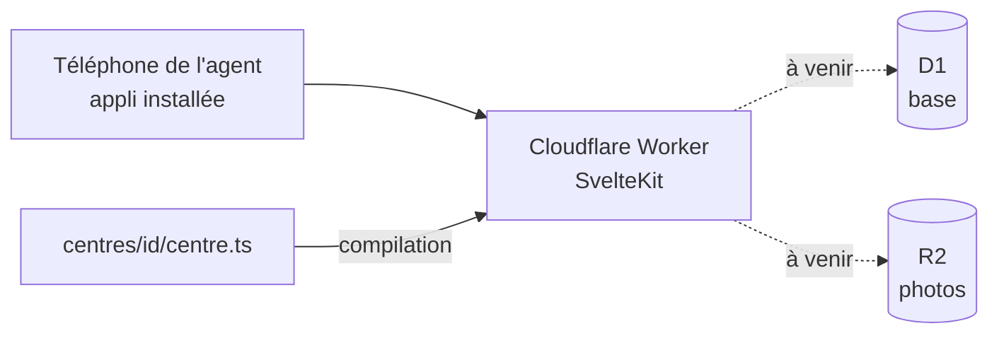

# Documentation technique

## Architecture

- Une installation par centre, sur son propre compte Cloudflare.
- Le centre est choisi à la compilation : `CENTRE=<id>` (par défaut `exemple`, un centre fictif). Une description incorrecte arrête la compilation.
- Les tests vérifient tous les centres de `centres/`, et `pnpm check` les vérifie aussi côté types.
- La config Cloudflare (nom de l'appli, et plus tard base et stockage) est celle du centre : `centres/<id>/wrangler.jsonc`. Sur le compte du CIS Laillé : `gyro-caserne-exemple` (préprod, démo) et `gyro-caserne-laille` (production).
- Installer un nouveau centre : [installer-un-centre.md](installer-un-centre.md).

## Dépôt

| Dossier | Rôle |
|---|---|
| `apps/web` | L'appli |
| `packages/centre` | Description d'un centre et sa validation |
| `centres/<id>` | Description d'un centre (`centres/exemple` : centre fictif, modèle) |

## CI

GitHub Actions (`.github/workflows/verifier.yml`), à chaque push sur `main` et à chaque PR : types, tests, compilation.
Droits en lecture seule, actions figées par leur empreinte de commit.
Déploiement préprod et production : à mettre en place.

## Technos

Versions exactes : dans les `package.json` (pnpm les fixe à chaque ajout, `saveExact`).

| Outil | Version | Rôle |
|---|---|---|
| Node | 24 LTS | Exécution des outils |
| pnpm | 12 | Paquets, monorepo |
| Turborepo | 2 | Enchaînement des tâches |
| SvelteKit | 3 | Appli |
| Adaptateur Cloudflare | 8 | Compilation pour Cloudflare |
| Svelte | 5 | Interface |
| Plugin Svelte pour Vite | 7 | Lecture des fichiers `.svelte` |
| svelte-check | 4 | Vérification des types des fichiers `.svelte` |
| Vite | 8 | Compilation |
| TypeScript | 6 | Typage |
| Types Cloudflare Workers | 5 | Types de l'environnement Cloudflare |
| Types Node | 24 | Types de Node, pour la config de compilation |
| Drizzle ORM | 0.45 | Accès à la base (D1 en production, SQLite en test) |
| drizzle-kit | 0.31 | Génère les migrations de la base |
| Vitest | 5 | Tests |
| Wrangler | 4 | Cloudflare (local et déploiement) |

Les choix sont expliqués dans `docs/decisions/`.
