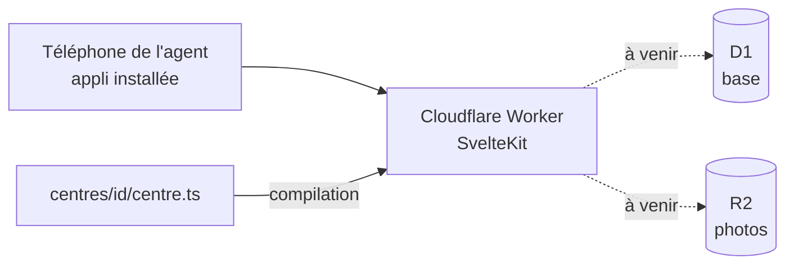

# Documentation technique

## Architecture

- Une installation par centre, sur son propre compte Cloudflare.
- Le centre est choisi à la compilation : `CENTRE=<id>` (Laillé par défaut). Sa description est validée à ce moment-là.

## Dépôt

| Dossier | Rôle |
|---|---|
| `apps/web` | L'appli |
| `packages/centre` | Description d'un centre et sa validation |
| `centres/<id>` | Description d'un centre |

## CI

GitHub Actions (`.github/workflows/verifier.yml`), à chaque push sur `main` et à chaque PR : types, tests, compilation.
Déploiement préprod et production : à mettre en place.

## Technos

Versions exactes : dans les `package.json`.

| Outil | Version | Rôle |
|---|---|---|
| Node | 24 LTS | Exécution des outils |
| pnpm | 12 | Paquets, monorepo |
| Turborepo | 2 | Enchaînement des tâches |
| SvelteKit | 3 | Appli |
| Adaptateur Cloudflare | 8 | Compilation pour Cloudflare |
| Svelte | 5 | Interface |
| Vite | 8 | Compilation |
| TypeScript | 6 | Typage |
| Vitest | 5 | Tests |
| Wrangler | 4 | Cloudflare (local et déploiement) |

Les choix sont expliqués dans `docs/decisions/`.
