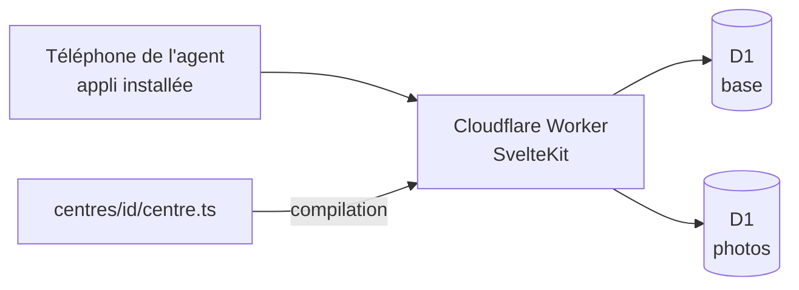

# Documentation technique

## Architecture

- Une installation par centre, sur son propre compte Cloudflare.
- Le centre est choisi à la compilation : `CENTRE=<id>` (par défaut `exemple`, un centre fictif). Une description incorrecte arrête la compilation.
- Les tests vérifient tous les centres de `centres/`, et `pnpm check` les vérifie aussi côté types.
- Deux bases D1 par centre : la base principale (liaison `BASE`) et la base des photos (liaison `PHOTOS`), qui ne contient que leurs octets. Une base gratuite tient 500 Mo : voir [0010](../decisions/0010-photos-dans-leur-base.md).
- La config Cloudflare (nom de l'appli, bases) est celle du centre : `centres/<id>/wrangler.jsonc`. Elle déclenche aussi, chaque nuit à 3 h 30 (UTC, `triggers.crons`), le gestionnaire planifié du worker : l'adaptateur Cloudflare n'écrit que `fetch`, alors `apps/web/src/entree-du-worker.ts` renomme son worker en `_sveltekit.js` (exclu des fichiers publiés) et écrit à sa place une entrée qui reprend `fetch` et ajoute `scheduled` (`planifie.ts` : effacement des vieux messages). Sur le compte du CIS Laillé : `gyro-caserne-exemple` (préprod, démo) et `gyro-caserne-laille` (production).
- Connexion par lien magique (Better Auth), réservée aux adresses autorisées : une personne du centre avec un statut qui donne accès, ou un super administrateur (`SUPER_ADMINS`). Une adresse inconnue reçoit le même message, sans lien.
- Option Cloudflare `nodejs_compat` : Better Auth utilise des modules de Node (`node:async_hooks` notamment).
- Le lien de connexion part en arrière-plan (`waitUntil`), au plus un par minute et par adresse (table `envoi_lien`, réservée en une seule requête) ; en base, seule l'empreinte du jeton est gardée.
- Les tables de connexion gardent les noms de Better Auth (`user`, `session`, `account`, `verification`) : il les attend tels quels.
- Tables et modèle des droits : [socle.md](socle.md).
- Installer un nouveau centre : [installer-un-centre.md](installer-un-centre.md).
- Passer la main au super administrateur suivant : [passation.md](passation.md).
- Interface (jetons, coquille, composants, Gyro, tests d'accessibilité) : [interface.md](interface.md).

## Dépôt

| Dossier | Rôle |
|---|---|
| `apps/web` | L'appli |
| `packages/centre` | Description d'un centre et sa validation |
| `packages/socle` | Personnes, profils, droits et attributions : schéma de la base, migrations et actions protégées |
| `centres/<id>` | Description d'un centre (`centres/exemple` : centre fictif, modèle) |

## CI

GitHub Actions, actions figées par leur empreinte de commit, droits en lecture seule sauf mention.

- `verifier.yml`, à chaque PR : types, tests, compilation, polices bien servies en fichiers `.woff2` (la CSP bloquerait une police glissée dans le CSS), puis tests d'accessibilité dans Chromium ([interface.md](interface.md)). En cas d'échec, leur rapport et la sortie du serveur sont joints au passage de la CI (« rapport-accessibilite »).
- `deployer.yml`, après la même vérification :
  - à chaque fusion sur `main` : mise à jour de la base puis déploiement de la **préprod** (centre `CENTRE_PREPROD`) ;
  - sur un tag `vX.Y.Z` : même chose pour la **production** (centre `CENTRE_PRODUCTION`), seulement si le tag pointe sur `main`. Si la base ne se met pas à jour, l'appli n'est pas déployée.
- Réglages du dépôt GitHub : variables `CENTRE_PREPROD` et `CENTRE_PRODUCTION` (sans elles, rien n'est déployé), secrets `CLOUDFLARE_API_TOKEN` et `CLOUDFLARE_ACCOUNT_ID`. Pour Laillé : `exemple` et `laille`.
- **Journal des mises en production** : chaque version déployée a sa fiche dans les « Releases » du dépôt (date, PR incluses, résumé en langage clair). Seul le job de production peut écrire ces fiches.
- Dépôt privé sur l'offre gratuite : pas d'environnements GitHub ni de règles sur les tags. La garde est le tag sur `main`, vérifié avant de déployer.

## Technos

Versions exactes : dans les `package.json` (pnpm les fixe à chaque ajout, `saveExact`).

| Outil | Version | Rôle |
|---|---|---|
| Node | 24 LTS | Exécution des outils |
| pnpm | 12 | Paquets, monorepo |
| Turborepo | 2 | Enchaînement des tâches |
| SvelteKit | 3 | Appli |
| Adaptateur Cloudflare | 8 | Compilation pour Cloudflare |
| Svelte | 5 | Interface |
| Plugin Svelte pour Vite | 7 | Lecture des fichiers `.svelte` |
| svelte-check | 4 | Vérification des types des fichiers `.svelte` |
| Vite | 8 | Compilation |
| TypeScript | 6 | Typage |
| Types Cloudflare Workers | 5 | Types de l'environnement Cloudflare |
| Types Node | 24 | Types de Node, pour la config de compilation |
| Drizzle ORM | 0.45 | Accès à la base (D1 en production, SQLite en test) |
| drizzle-kit | 0.31 | Génère les migrations de la base |
| @fontsource/barlow, barlow-condensed | 5.3.0 | Polices servies par l'appli (la CSP interdit Google Fonts) |
| Better Auth | 1.7 | Connexion par lien magique et sessions |
| Brevo | API v3 | Envoi des courriels (liens de connexion), par simple requête HTTP, sans bibliothèque ([0007](../decisions/0007-brevo.md)) |
| write-excel-file | 4.1.1 | Écrit le fichier de l'effectif (`.xlsx`, listes déroulantes), dans le navigateur |
| read-excel-file | 9.3.12 | Relit le fichier de l'effectif, dans le navigateur |
| Vitest | 5 | Tests |
| Playwright (`@playwright/test`) | 1.64.1 | Tests dans un vrai navigateur (Chromium), aux tailles téléphone et ordinateur |
| axe pour Playwright (`@axe-core/playwright`) | 4.14.0 | Contrôle automatique des règles WCAG A et AA, base des tests RGAA |
| Wrangler | 4 | Cloudflare (local et déploiement) |

Fichier de l'effectif : write-excel-file et read-excel-file sont petits, maintenus et s'appuient sur fflate (zip) ; ExcelJS est écarté (21 Mo, plus maintenu, flux propres à Node). Le classeur est écrit et lu dans le navigateur, car l'offre gratuite de Workers limite le temps de calcul par requête. Le paquet du socle est déclaré sans effet de bord (`sideEffects: false`) : le navigateur n'en reçoit que ce qu'il importe (libellés des statuts), pas l'accès à la base.

Les choix sont expliqués dans `docs/decisions/`.
