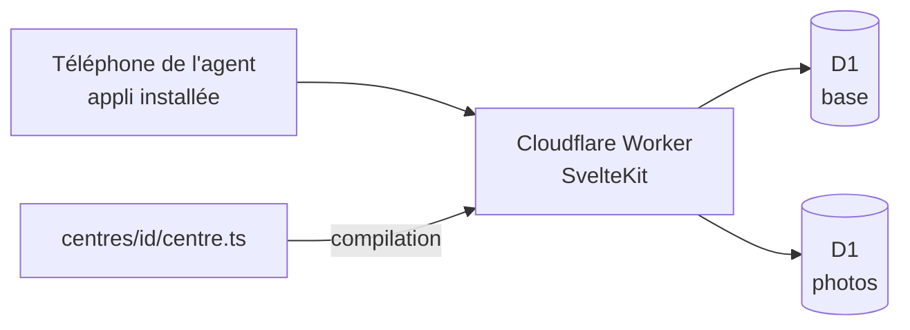

# Documentation technique

## Architecture

- Une installation par centre, sur son propre compte Cloudflare.
- Le centre est choisi à la compilation : `CENTRE=<id>` (par défaut `exemple`, un centre fictif). Une description incorrecte arrête la compilation.
- Les tests vérifient tous les centres de `centres/`, et `pnpm check` les vérifie aussi côté types.
- Deux bases D1 par centre : la base principale (liaison `BASE`) et la base des photos (liaison `PHOTOS`), qui ne contient que leurs octets. Une base gratuite tient 500 Mo : voir [0010](../decisions/0010-photos-dans-leur-base.md).
- La config Cloudflare (nom de l'appli, adresse, bases) est celle du centre : `centres/<id>/wrangler.jsonc`. L'adresse de l'appli (`vars.BETTER_AUTH_URL`) y est en clair, ce n'est pas un secret ; en local, `.dev.vars` l'emporte ([0024](../decisions/0024-adresse-dans-la-config.md)). Les adresses de prévisualisation sont coupées (`preview_urls: false`) : plus de version d'essai en ligne depuis la fin de la refonte ([0022](../decisions/0022-branche-refonte-ui.md), [0026](../decisions/0026-refonte-ui-2.md)).
- Notifications au téléphone : Web Push sans bibliothèque (`apps/web/src/lib/server/webpush.ts`, `envoi-push.ts`), clés VAPID en secrets ; l'appli est installable (`static/manifest.webmanifest`, icônes dans `static/icones/` (sources `icone.svg` et `icone-masquable.svg`, PNG régénérés depuis elles par Chromium avec un script jetable, hors du dépôt), `src/service-worker.ts` qui reçoit (en gardant la plus récente d'un fil, `lib/notification-recue.ts`, et en posant la pastille sur l'icône, `lib/pastille.ts`) et ouvre les notifications et affiche l'écran d'attente, sans rien mettre en cache). Aide à l'installation : `lib/installation.ts` (choix selon l'appareil), `lib/installation.svelte.ts` (garde l'évènement `beforeinstallprompt` dès le chargement), `lib/ui/Installer.svelte` (Accueil et Moi → Installer l'appli). Sur le compte du CIS Laillé : `gyro-caserne-exemple` (préprod, démo) et `gyro-caserne-laille` (production).
- **Coupure de l'offre gratuite** (erreur Cloudflare 1102 : 503 en texte brut, « error code: 1102 ») : le service worker, enregistré par SvelteKit dès la première page chargée, montre une page d'attente autonome et réessaie seul à 5, 10 puis 20 s (`lib/attente/attente.ts`, [décision 0021](../decisions/0021-calcul-et-reprises.md)). Un envoi n'est jamais renvoyé.
- Dates : `formatDeDate` (`@gyro-caserne/socle/dates`) garde chaque format `Intl` ; ne jamais écrire `new Intl.DateTimeFormat` ni `toLocaleDateString` dans le code de l'appli : c'est le plus gros coût de calcul d'une page de planning.
- Connexion par lien magique (Better Auth), réservée aux adresses autorisées : une personne du centre avec un statut qui donne accès, ou un super administrateur (`SUPER_ADMINS`). Une adresse inconnue reçoit le même message, sans lien.
- Option Cloudflare `nodejs_compat` : Better Auth utilise des modules de Node (`node:async_hooks` notamment).
- Le lien de connexion part en arrière-plan (`waitUntil`), au plus un par minute et par adresse (table `envoi_lien`, réservée en une seule requête) ; en base, seule l'empreinte du jeton est gardée.
- Le même courriel porte un code à 6 chiffres (plugin `emailOTP` de Better Auth, type `sign-in`), créé dans l'envoi du lien, après la réservation : 5 minutes, 3 essais, usage unique, empreinte HMAC liée à `BETTER_AUTH_SECRET`. Le code utilisé efface le lien (crochet `after` sur `/sign-in/email-otp`). Les autres routes du plugin sont fermées (`disabledPaths`). Page de connexion : actions `envoyer` et `code` ([0034](../decisions/0034-code-de-connexion.md)).
- Les tables de connexion gardent les noms de Better Auth (`user`, `session`, `account`, `verification`) : il les attend tels quels.
- Tables et modèle des droits : [socle.md](socle.md).
- Installer un nouveau centre : [installer-un-centre.md](installer-un-centre.md).
- Passer la main au super administrateur suivant : [passation.md](passation.md).
- Sauvegarde (retour en arrière de D1, copie hebdomadaire chiffrée par e-mail) : [sauvegarde.md](sauvegarde.md).
- Interface (jetons, coquille, composants, Gyro, tests d'accessibilité) : [interface.md](interface.md).

## Dépôt

| Dossier | Rôle |
|---|---|
| `apps/web` | L'appli |
| `packages/centre` | Description d'un centre et sa validation |
| `packages/socle` | Personnes, profils, droits et attributions : schéma de la base, migrations et actions protégées |
| `centres/<id>` | Description d'un centre (`centres/exemple` : centre fictif, modèle) |

## CI

GitHub Actions, actions figées par leur empreinte de commit, droits en lecture seule sauf mention.

- `verifier.yml`, à chaque PR (sauf si seuls `docs/` ou des `.md` changent : une PR de doc seule n'a pas de vérification) : types, tests, compilation, polices bien servies en fichiers `.woff2` (la CSP bloquerait une police glissée dans le CSS), puis tests d'accessibilité dans Chromium, sur l'appli compilée ([interface.md](interface.md)). Pour aller plus vite (le dépôt est public : les minutes GitHub ne sont plus comptées), une PR en **brouillon** n'a que la vérification rapide (tests, compilation, environ 5 min) ; la vérification complète (types et accessibilité) part quand la PR passe « prête » et à la relance manuelle (`gh workflow run verifier.yml --ref <branche>`). Avant la préprod, seulement la rapide (la PR fusionnée a déjà eu la complète) ; avant la production, la complète. En cas d'échec, leur rapport et la sortie du serveur sont joints au passage de la CI (« rapport-accessibilite »).
- `deployer.yml`, après la même vérification :
  - à chaque fusion sur `main` : mise à jour de la base puis déploiement de la **préprod** (centre `CENTRE_PREPROD`) ;
  - sur un tag `vX.Y.Z` : même chose pour la **production** (centre `CENTRE_PRODUCTION`), seulement si le tag pointe sur `main`. Si la base ne se met pas à jour, l'appli n'est pas déployée.
  - après chaque déploiement, préprod et production, un **contrôle** (`apps/web/scripts/controle-deploiement.ts`) : le passage échoue, avec les noms manquants, si `BETTER_AUTH_SECRET`, `SUPER_ADMINS`, `BREVO_CLE` (lus par `wrangler secret list`, noms seulement) ou l'adresse de l'appli (config ou secret) manque ; l'adresse appelée est celle de la config, que chaque déploiement pose sur le Worker,, ou si `GET /connexion` ne répond pas 200 (six essais en une minute). Aucune valeur de secret ni adresse e-mail dans le journal, aucun courriel envoyé.
- `releve-coupures.yml`, chaque matin (sans installer l'appli, moins d'une minute) : demande à Cloudflare (GraphQL, `workersInvocationsAdaptive`) le nombre de requêtes coupées la veille (statut `exceededResources`) et le temps de calcul (moyenne ; médiane, pire temps p99 et maximum de toutes les requêtes du jour, réveils compris), pour `gyro-caserne-<centre>` en préprod et en production (si `CENTRE_PRODUCTION` existe). **Une coupure fait échouer le passage** (un pire temps p99 au-delà de 150 ms ajoute seulement un avertissement, qui prévient avant la première coupure) : GitHub prévient par courriel celui qui a modifié le fichier en dernier ; les chiffres sont dans le résumé du passage. Aucun secret affiché. Jeton : le `CLOUDFLARE_API_TOKEN` existant suffit. GitHub suspend les tâches planifiées après 60 jours sans activité sur le dépôt.
- `copie-hebdomadaire.yml`, chaque dimanche (et à la main, production ou préprod) : la base principale de la production est exportée, compressée, chiffrée avec age pour le porteur, puis envoyée par Brevo à la boîte du centre. Elle n'est jamais gardée sur GitHub : `permissions: {}`, ni artefact ni cache, fichiers effacés même après un échec, aucune donnée dans le journal. Tant que `CENTRE_PRODUCTION` est vide, rien n'est fait. Au-delà de 4 000 000 octets chiffrés, échec sans envoi. Voir [sauvegarde.md](sauvegarde.md).
- `comptes-de-test.yml`, lancé à la main depuis `main` (préprod du centre `exemple` seulement) : un compte par profil et des données fictives, voir le [README](../../README.md).
- Réglages du dépôt GitHub : variables `CENTRE_PREPROD` et `CENTRE_PRODUCTION` (sans elles, rien n'est déployé), secrets `CLOUDFLARE_API_TOKEN` et `CLOUDFLARE_ACCOUNT_ID` ; facultatifs, posés sur le Worker au déploiement : `VAPID_PUBLIQUE_PREPROD`, `VAPID_PRIVEE_PREPROD` (et `…_PRODUCTION`), `VIGILANCE_CLE`. Pour la copie hebdomadaire : variables `COPIE_CLE_PUBLIQUE_PRODUCTION` et `COPIE_DESTINATAIRE`, secret `BREVO_CLE_PRODUCTION`, facultatif `COURRIEL_EXPEDITEUR_PRODUCTION` ([sauvegarde.md](sauvegarde.md)). Pour Laillé : `exemple` et `laille`.
- **Journal des mises en production** : chaque version déployée a sa fiche dans les « Releases » du dépôt (date, PR incluses, résumé en langage clair). Seul le job de production peut écrire ces fiches.
- Dépôt public. `main` est protégée dans GitHub : PR obligatoire, administrateurs compris, ni poussée forcée ni suppression (aucune vérification exigée avant fusion). Pas d'environnements GitHub ni de règles sur les tags : la garde de la production est le tag sur `main`, vérifié avant de déployer.

## Technos

Versions exactes : dans les `package.json` (pnpm les fixe à chaque ajout, `saveExact`).

| Outil | Version | Rôle |
|---|---|---|
| Node | 24 LTS | Exécution des outils |
| pnpm | 12 | Paquets, monorepo |
| Turborepo | 2 | Enchaînement des tâches |
| SvelteKit | 3 | Appli |
| Adaptateur Cloudflare | 8 | Compilation pour Cloudflare |
| Svelte | 5 | Interface |
| Plugin Svelte pour Vite | 7 | Lecture des fichiers `.svelte` |
| svelte-check | 4 | Vérification des types des fichiers `.svelte` |
| Vite | 8 | Compilation |
| TypeScript | 6 | Typage |
| Types Cloudflare Workers | 5 | Types de l'environnement Cloudflare |
| Types Node | 24 | Types de Node, pour la config de compilation |
| Drizzle ORM | 0.45 | Accès à la base (D1 en production, SQLite en test) |
| drizzle-kit | 0.31 | Génère les migrations de la base |
| @fontsource/barlow, barlow-condensed | 5.3.0 | Polices servies par l'appli (la CSP interdit Google Fonts) |
| Better Auth | 1.7 | Connexion par lien magique ou code (plugins `magicLink`, `emailOTP`) et sessions |
| Brevo | API v3 | Envoi des courriels (lien et code de connexion), par simple requête HTTP, sans bibliothèque ([0007](../decisions/0007-brevo.md)) |
| write-excel-file | 4.1.1 | Écrit le fichier de l'effectif (`.xlsx`, listes déroulantes), dans le navigateur |
| read-excel-file | 9.3.12 | Relit le fichier de l'effectif, dans le navigateur |
| age | 1.3.2 | Chiffre la copie hebdomadaire de la base pour la clé publique du porteur. Binaire officiel téléchargé par le workflow à une adresse fixe, empreinte SHA-256 vérifiée (la même que celle publiée par GitHub pour la version). Choisi plutôt que gpg pour sa simplicité côté porteur ([0030](../decisions/0030-copie-hebdomadaire.md)) |
| Vitest | 5 | Tests |
| Playwright (`@playwright/test`) | 1.64.1 | Tests dans un vrai navigateur (Chromium), aux tailles téléphone et ordinateur |
| axe pour Playwright (`@axe-core/playwright`) | 4.14.0 | Contrôle automatique des règles WCAG A et AA, base des tests RGAA |
| Wrangler | 4 | Cloudflare (local et déploiement) |

Fichier de l'effectif : write-excel-file et read-excel-file sont petits, maintenus et s'appuient sur fflate (zip) ; ExcelJS est écarté (21 Mo, plus maintenu, flux propres à Node). Le classeur est écrit et lu dans le navigateur, car l'offre gratuite de Workers limite le temps de calcul par requête. Le paquet du socle est déclaré sans effet de bord (`sideEffects: false`) : le navigateur n'en reçoit que ce qu'il importe (libellés des statuts), pas l'accès à la base.

Les choix sont expliqués dans `docs/decisions/`.
