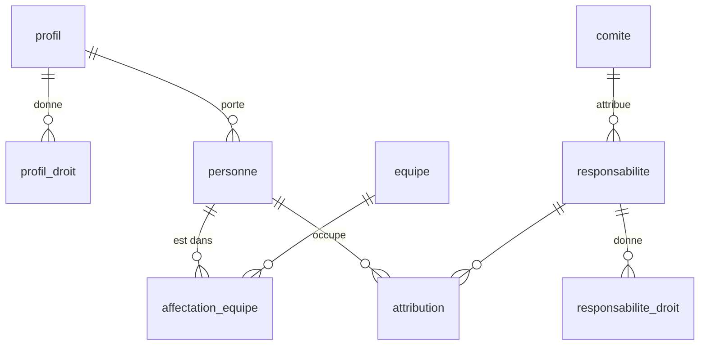

# Socle : tables et droits

Le paquet `packages/socle` porte la base (schéma Drizzle, migrations) et les actions protégées par les droits.

## Tables principales

| Table | Contenu |
|---|---|
| `personne` | Une adresse autorisée : nom, grade, profil, statut opérationnel |
| `profil`, `profil_droit` | Droits de base d'un type de personne (agent, réserve citoyenne…), chacun sur un périmètre |
| `equipe`, `affectation_equipe` | Équipes du centre et qui y est, avec dates |
| `responsabilite`, `responsabilite_droit` | Fonctions (chef de centre…) et missions (référent pharmacie…), avec leurs droits ; `archivee_le` : date d'archivage, vide tant qu'elle sert ; `modele` : modèle d'origine (vide pour un rôle fait à la main) ; `icone` : icône choisie (vide : l'appli choisit) |
| `attribution` | Qui occupe quelle responsabilité, sur quel périmètre, de quand à quand |
| `comite` | Comités du centre ; un comité peut attribuer des responsabilités ; `dissous_le` : date de dissolution, vide tant qu'il existe |
| `grade`, `champ_centre`, `valeur_champ` | Grades, et champs de fiche propres au centre |
| `journal` | Chaque action sensible : auteur, date, cible, détails |
| `user`, `session`, `account`, `verification` | Connexion (Better Auth, noms imposés) |
| `envoi_lien` | Dernier lien de connexion envoyé à chaque adresse (un par minute) |

Les dates sont des textes `AAAA-MM-JJ` ; une attribution ou une affectation est en cours si `debut <= date <= fin` (fin vide : sans fin).

## Migrations

- Générées par `pnpm migrations` (drizzle-kit) dans `packages/socle/migrations/`, appliquées dans l'ordre.
- La préprod a des données : une migration publiée n'est jamais réécrite, une nouvelle n'efface ni ne transforme rien.
- Une donnée de départ ajoutée après coup va dans le jeu de départ (bases vides) **et** dans la migration, en insertion gardée qui ne joue que sur une base déjà remplie (`EXISTS profil`) et sans doublon (`NOT EXISTS`). Exemple : `0001` ajoute le « Référent technique ».

## Droits

- Un **droit** (`GERER_ACCES`, `VOIR_PLANNING`…) est toujours accordé sur un **périmètre** : le centre, une équipe, un comité…
  Le centre couvre tous les périmètres ; sinon, il faut le même périmètre.
- **Droits de pouvoir** (`DROITS_POUVOIR`, `estDroitPouvoir`) : `GERER_ACCES`, `ATTRIBUER_RESPONSABILITE`, `GERER_LISTES`, `GERER_COMITES`. Tous les autres sont des droits métier.
- Une personne tient ses droits de deux sources :
  - son **profil** ;
  - ses **attributions en cours**, chacune sur le type de périmètre de sa responsabilité.
- Une personne sans accès (suspendue, partie) n'a aucun droit. Le **super administrateur** (`SUPER_ADMINS`) a tous les droits sur le centre.
- Exceptions, sur le **code système** de la responsabilité (`responsabilite.systeme`) :
  - `chef_centre` : nommé ou retiré par un super administrateur seulement ;
  - `chef_centre_adjoint` (mêmes droits) : nommé ou retiré par le chef de centre en cours (`estChefDeCentre`) ou un super administrateur ; `ATTRIBUER_RESPONSABILITE` ne suffit pas ;
  - `chef_equipe` : responsabilité repérée, sans règle à part.
- `changerStatut` :
  - le statut du chef de centre en cours ne change que par un super administrateur ;
  - celui d'un adjoint en cours, que par le chef de centre en cours ou un super administrateur ;
  - « en cours » : un chef de centre nommé à l'avance n'est protégé qu'à partir de sa prise de fonction ;
  - quitter « suspendu » ou « parti » exige `GERER_ACCES` sur le centre ;
  - sans `GERER_ACCES` sur le centre, l'acteur ne touche qu'une personne sans attribution en cours ou à venir, dont il détient tous les droits du profil ;
  - vers « parti » : naissance et contact d'urgence effacés dans le même `batch` ; ils restent vides au retour. La personne quitte aussi son équipe dans ce `batch`, avec la même logique que `retirerEquipe` (partagée) : affectation en cours terminée la veille ou supprimée si elle commence aujourd'hui, affectations à venir supprimées, journal `retirer_equipe` ; sans équipe, aucune erreur. Dans ce même `batch`, `finirOuSupprimer` sur toutes ses attributions (en cours : fin la veille ; commençant aujourd'hui ou plus tard : supprimées ; passées : gardées). Au retour, ni équipe ni rôle : il faut réaffecter et renommer.
- `modifierFiche` : `GERER_ACCES` sur le centre, et la même protection du chef de centre et des adjoints que `changerStatut` (messages propres à la fiche) :
  - seuls les champs changés sont écrits ; le journal (`modifier_fiche`) n'en garde que les noms, jamais les valeurs (un effacement au départ ne doit pas y survivre), sauf l'adresse : `details.email` porte `{ avant, apres }` ; rien de changé, rien d'écrit ;
  - l'adresse est normalisée et unique (« Adresse déjà utilisée ») ; la changer ferme, dans le même `batch`, les sessions et les liens en attente de l'ancienne. La ligne `user` de Better Auth garde l'ancienne adresse, qui ne se connecte plus (aucune fiche) ; la nouvelle crée son compte à la première connexion.
- `retirerEquipe` : `GERER_ACCES` sur le centre et la même protection du chef de centre et des adjoints ; l'affectation en cours se termine la veille (effet le jour même), ou est supprimée si elle commence aujourd'hui ; les affectations à venir sont supprimées ; journal `retirer_equipe`.
- `affecterEquipe` : `GERER_ACCES` sur le centre et la même protection du chef de centre et des adjoints ; même équipe que l'affectation ouverte → rien d'écrit ; même jour de début → l'équipe de cette affectation est corrigée ; sinon l'affectation ouverte se termine la veille du début ; journal `affecter_equipe`.
- `ajouterPersonne` accepte aussi grade, date de grade, téléphone, naissance, entrée au centre et engagement SPV, dates vérifiées, et un statut facultatif (« opérationnel » par défaut ; « parti » est refusé : « Statut impossible à la création »).
- Adresse réservée : `ajouterPersonne` et `modifierFiche` reçoivent la liste des super administrateurs (`adressesReservees`, obligatoire) et refusent leur adresse, normalisée, par `DonneeInvalide('Adresse réservée au super administrateur')`, avant toute écriture. `ajouterPersonne` ne la contrôle qu'après les droits : sans droit sur la cible, `RefusDroit`, et l'adresse ne se devine pas. Le formulaire web et le fichier de l'effectif passent par cette règle.
- Adresse unique, même en concurrence : si deux écritures passent le contrôle préalable, la contrainte UNIQUE de `personne.email` fait échouer la seconde ; `ajouterPersonne` et `modifierFiche` traduisent cette erreur en `DonneeInvalide('Adresse déjà utilisée')`.
- Longueurs maximales, refusées par `DonneeInvalide('<Champ> trop long')` dans `ajouterPersonne`, `modifierFiche` et `modifierMonProfil` : prénom, nom, surnom 60 ; téléphone 20 ; contact d'urgence 200 ; adresse 254 (« Adresse trop longue »). L'interface pose les mêmes bornes en `maxlength`.
- Côté écran, « Aucune équipe » appelle toujours `retirerEquipe` (qui retire aussi une affectation à venir) ; sans rien à retirer (« Aucune équipe en cours »), la page répond « Aucune équipe à retirer. ».
- Fin de période (`fin-de-periode.ts`, `finirOuSupprimer`) : règle commune aux équipes, aux dissolutions et aux archivages. Parmi les lignes visées encore ouvertes (fin vide ou ≥ aujourd'hui), celles commencées avant aujourd'hui se terminent la veille, les autres sont supprimées. Renvoie deux requêtes à placer dans le `batch` de l'action.
- Comités (`actions/comites.ts`), tous avec `GERER_COMITES` sur le centre :
  - `listerComites` (avec `estCentre`, `membresEnCours` et `rapporteurs` : qui tient, dans le comité, un rôle de portée comité non archivé portant `ATTRIBUER_RESPONSABILITE`, attribution en cours, personne présente), `creerComite`, `modifierComite` (seuls les champs changés ; journal sans valeurs), `dissoudreComite` ;
  - nom et thème : non vides, 60 caractères au plus ; nom unique parmi tous les comités, dissous compris, sans casse ni espaces de bord (« Nom déjà utilisé ») ;
  - le comité du centre, repéré par son nom (`NOM_COMITE_CENTRE`), ne se renomme pas et ne se dissout pas ; un comité dissous ne se modifie plus ;
  - `dissoudreComite` refuse (`DonneeInvalide('Changez d’abord qui attribue « nom »')`, rien d'écrit) tant qu'une responsabilité non archivée de portée « comité » a ce comité pour `comite_attributeur_id` ; sinon, en un `batch` : `finirOuSupprimer` sur les attributions dont le périmètre est ce comité, `comite_attributeur_id` remis à vide pour les responsabilités de centre ou d'équipe qu'il attribuait (le chef de centre attribue), `dissous_le` = aujourd'hui, journal `dissoudre_comite` avec `attributionsClose`.
- Responsabilités (`actions/responsabilites.ts`), toutes avec `GERER_LISTES` sur le centre :
  - `listerResponsabilites` (droits avec `verrouille`, `titulaires` en cours, `protegee`), `creerResponsabilite`, `modifierResponsabilite` (nom, nature, portée, attributeur, droits), `archiverResponsabilite` ;
  - « gère le pouvoir » : super administrateur ou `GERER_ACCES` sur le centre. Sans lui, refus (`RefusDroit` avec raison) d'ajouter ou de retirer un droit de pouvoir, et de modifier ou d'archiver une responsabilité qui en porte un (`protegee` côté liste) ;
  - attributeur (`Attributeur`) : `chef_centre` (portée centre ou équipe), `comite_vise` (portée comité seulement), `comite` + id (comité existant, non dissous). Stocké dans `comite_attributeur_id` : renseigné = ce comité ; vide et portée comité = le comité visé ; vide sinon = le chef de centre ;
  - nom unique parmi toutes les responsabilités, archivées comprises (même règle que les comités) ; nature et portée connues ; droits connus ;
  - la portée ne change pas pour une responsabilité système, ni tant qu'une attribution est en cours ou à venir ; un droit verrouillé ne se retire pas ; une responsabilité archivée ne se modifie plus ;
  - `archiverResponsabilite` : refusée pour une responsabilité système ; en un `batch` : `finirOuSupprimer` sur ses attributions, `archivee_le` = aujourd'hui, journal `archiver_responsabilite` avec `attributionsClose`.
- Modèles (`modeles.ts`, `MODELES`) : fixés par l'appli, chacun avec nom, nature, portée, icône et droits : Référent matériel, Référent pharmacie, Référent technique, Membre de comité, Rapporteur de comité, Vierge. `creerResponsabilite` accepte `modele` (identifiant connu, sinon `DonneeInvalide('Modèle inconnu')`) et le garde ; sans icône choisie, il prend celle du modèle. Un modèle qui porte un droit de pouvoir suit la règle du pouvoir comme tout autre droit.
- Icônes (`icones.ts`) : `NOMS_ICONES` (les tracés sont dans l'appli, mêmes noms) et `iconeDuRole`, seule règle partagée par l'accueil et les réglages : l'icône choisie, sinon celle du modèle, sinon d'après le nom (engin, pharmacie, technique), sinon celle du thème (étoile pour chef de centre et adjoint, casque pour une portée équipe, groupe pour une portée comité, outil sinon). `modifierResponsabilite` refuse une icône inconnue (`Icône inconnue`).
- Profils (`actions/profils.ts`), réservés à qui « gère le pouvoir » (sinon `RefusDroit`) : `listerProfils` (droits sur le centre seulement) et `modifierDroitsProfil`, qui remplace les droits sur le centre d'un profil (les autres périmètres, comme un salon, ne bougent pas), refuse un droit de pouvoir (`Un profil ne donne pas de droit de pouvoir`), n'écrit rien sans changement, et journalise `modifier_droits_profil` avec `{ avant, apres }` dans le même `batch`.
- `attribuer` refuse une personne partie (`DonneeInvalide('Cette personne est partie')`), une responsabilité archivée et un périmètre « comité » dissous, et le doublon : même personne, même responsabilité, même périmètre, périodes qui se chevauchent (`DonneeInvalide('Cette personne tient déjà ce rôle sur cette période')`).
- Nominations (`actions/attributions.ts`). Une seule règle, `exigerAttribution`, dit qui attribue ou retire quoi ; les lectures s'en servent pour filtrer, sans la recopier :
  - `terminerAttribution` : mêmes droits que `finirAttribution` ; `finirOuSupprimer` sur cette attribution (perte du rôle aujourd'hui, annulation si elle commence aujourd'hui ou plus tard) ; refuse une attribution déjà terminée ; journal `terminer_attribution` avec `annulee` et `personneId` (la personne reste connue si l'attribution est supprimée) ;
  - `attributionsDe` (gestionnaires seulement) : les rôles d'une personne, en cours, à venir et passés, avec le nom du périmètre (équipe, comité ; rien pour le centre), l'auteur (« Prénom Nom » ou « Super administrateur ») et `peutTerminer` ;
  - `ceQueJePeuxAttribuer` : les responsabilités non archivées que l'acteur peut attribuer, avec leurs périmètres possibles (« Centre », équipes actives, comités non dissous) ; vide pour un agent ordinaire ;
  - `peutAttribuerQuelqueChose` : même règle, s'arrête au premier rôle attribuable (vrai d'emblée pour le super administrateur) ; sert au menu ;
  - `titulairesDe` : titulaires en cours et à venir d'une responsabilité, limités aux périmètres que l'acteur peut attribuer ;
  - `titulairesDesMiens` : la même chose pour toutes les responsabilités que l'acteur peut attribuer, ses droits lus une seule fois (page « Nominations »).
- `vueEffectif` (`effectif.ts`, vue de tous) : groupes par équipe active, puis « Sans équipe », « Extérieurs », « Partis », chacun avec une `cle` stable (`equipe:<id>`, `sans-equipe`, `exterieurs`, `partis`) ; chaque personne porte `roles`, ses rôles en cours triés (« Chef d’équipe (Équipe 1) » ; nom seul pour le centre), en une requête filtrée sur la date du jour ; ni dates ni auteur. Une responsabilité archivée ou un comité dissous n'y figure plus.
- `droitsDe(base, acteur, date)` liste les droits tenus ; `aLeDroit(base, acteur, droit, perimetre, date)` répond oui ou non. Toute action du socle commence par là et refuse avec `RefusDroit`, dont le message dit pourquoi quand le refus vient d'une des règles ci-dessus.
- Droits lus une fois par requête : `droitsDe` garde sa réponse par base (`WeakMap`, clé acteur + date) ; `hooks.server.ts` crée une base par requête HTTP, le cache ne vit donc qu'une requête. Toute requête qui n'est pas un `select` (insertion, mise à jour, suppression, `batch` qui en contient une) le vide avant de partir : `creerBaseD1` surveille `prepare` de D1, la base de test son propre envoi. Un échec de lecture n'est pas gardé. Budget D1 (50 requêtes par appel du Worker) : pour un chef de centre et 150 agents, `/agents/<id>` 28 requêtes, avec l'action `?/fiche` et le rechargement 40, `/reglages/roles/<id>` 20, `/nominations` 23, `/` 10, hors session (`apps/web/src/routes/budget.test.ts`, 45 au plus).
- Une action qui écrit plusieurs lignes (dont le journal) passe en un seul `batch` : tout ou rien.

## Murs

Règles fonctionnelles : [salons.md](../fonctionnel/salons.md). Migrations additives : `0003` (les murs), `0004` (`publication.sondage_ouverture`, `publication.sondage_cloture`), `0005` (`comite.icone`). `0006` refait `photo_publication` vide, sans octets, avec `photo_id` (données fictives de la préprod seulement).

| Table | Contenu |
|---|---|
| `publication` | Une publication d'un mur (`mur` : clé `centre`, `vie`, `equipe:<id>`, `comite:<id>`) ; auteur au format du journal (`personne:<id>` ou `super:<email>`) ; type, texte, prise de connaissance, épingle, commentaires fermés ; événement (`debut`, `lieu`, `convoques` en JSON) et sondage (question, réponses en JSON, `sondage_ouverture` et `sondage_cloture` à la minute, vides pour un sondage publié avant les dates : toujours ouvert) |
| `commentaire`, `jaime` | Fil de commentaires et « J'aime » |
| `reponse_evenement`, `vote_sondage`, `prise_connaissance` | Une ligne par personne et par publication |
| `photo_publication` | Les photos d'une publication (ordre, type, 4 au plus) ; `photo_id` renvoie à la base des photos |
| `visite_mur` | Dernière visite d'une personne sur un mur (nouveautés) |
| `comite.icone` | Icône du mur du comité, parmi `NOMS_ICONES` ; vide : celle du thème |
| `personne.anniversaire_visible` | 1 par défaut ; 0 : l'anniversaire n'est pas affiché |

Supprimer une publication supprime ses lignes liées (`ON DELETE CASCADE`).

### Base des photos

Une base D1 à part (liaison `PHOTOS`, `creerBasePhotos`, `locals.basePhotos`), car une base gratuite tient 500 Mo : voir [0010](../decisions/0010-photos-dans-leur-base.md). Schéma `src/schema-photos.ts`, migrations `migrations-photos/` (`pnpm --filter @gyro-caserne/socle migrations-photos`). Une seule table, `photo` : `type` (JPEG ou WebP), `donnees` (les octets, 200 Ko au plus), `taille` (en octets), `cree_le`. Aucun lien vérifiable d'une base à l'autre : c'est le socle qui tient les deux ensemble.

- `publier` écrit les octets en un `batch` (qui rend les identifiants), puis la publication et ses `photo_publication` en un `batch` ; si ce second `batch` échoue, les octets sont effacés et l'erreur d'origine remonte.
- `supprimerPublication` supprime dans la base principale, puis les octets ; si cet effacement échoue, ils restent orphelins, sans erreur pour l'agent.
- `photo` vérifie l'accès dans la base principale, puis lit les octets.
- `remplissagePhotos` : la somme des `taille` en une requête, sur 500 Mo, `alerte` à partir de 80 %. Affichée sur la page Réglages (chef de centre, adjoint, super administrateur).
- La base de test (`test/base-de-test.ts`) a la base des photos dans `base.photos` ; `base.requetes` compte les deux bases (budget D1).

- `murs.ts` : `mursEtAppartenances` (et `mursDe`) déduit les murs d'un acteur et ses droits (`peutPublier`, `peutModerer`, `lectureSeule`) de son appartenance du jour, en **un `batch`** : fiche et profil, rôles tenus, affectations, équipes, comités. Aucun droit enregistré par mur. `exigerMur` / `accesMur` refusent par `RefusDroit` (`LIRE_SALON`, `PUBLIER_SALON`, `MODERER_SALON`). `estMembre` et `estConvoque` : qui est attendu dans un suivi, qui est convoqué. `lecturesAgents` (lectures à mettre dans un `batch`), `agentsDuJour` et `membresDe` : les agents du jour avec leurs appartenances, et les membres d'un mur ; `audiences` : le nombre de membres de plusieurs murs en une requête (« Visible par … »).
- `icones.ts` : `iconeDuComite` donne l'icône choisie, sinon celle du thème (`coeur` pour « amicale », `etoile` pour « centre », `groupe` sinon).
- `apercus.ts` : `apercusDesMurs` (2 requêtes au plus) donne pour chaque mur son identité (icône, couleur et numéro d'équipe), si l'acteur en est membre, et sa dernière publication (auteur, début du texte sur une ligne, date).
- `actions/publications.ts` : `publier` (types, prise de connaissance réservée aux modérateurs, photos JPEG ou WebP, sondage 2 à 6 réponses avec clôture obligatoire, après l'ouverture, à moins d'un an et pas après le début de l'événement, événement à venir ; octets dans la base des photos, puis publication, journal et références en un `batch`), `modifierPublication`, `supprimerPublication` (journal sans le contenu), `epingler`, `fermerCommentaires`, `lireMur` (épinglées puis 20 publications par page, 30 au plus, avec leurs 2 derniers commentaires ; note la visite ; donne l'audience du mur et, pour chaque publication, le visage de l'auteur — couleur d'équipe, rôle —, les présents d'un événement et le compte « faites sur attendues » d'une annonce), `lirePublication` (sans noter la visite), `photo` (vérifie que l'acteur lit le mur), `remplissagePhotos`.
- `actions/interactions.ts` : `commenter`, `supprimerCommentaire`, `lireCommentaires`, `aimer`, `repondreEvenement` (convoqués seulement), `voter` (refusé avant l'ouverture et dès la clôture, `etatSondage` : à la minute), `prendreConnaissance`, `suiviPublication` (qui a pris connaissance et qui pas encore ; présents, absents, incertains, sans réponse). Le super administrateur, sans fiche, n'aime, ne répond ni ne vote.
- `a-ne-pas-manquer.ts` : `aNePasManquer` (2 requêtes : les murs, puis un `batch` de lectures) donne annonces à prendre en compte (90 derniers jours), événements à venir où l'acteur est convoqué, sondages ouverts, épinglées récentes (30 jours) et nouveautés par mur (depuis la dernière visite, 14 jours sans visite) ; seulement les murs dont il est membre, hors lecture seule. `anniversairesDuJour` : jour et mois de Paris, jamais l'âge.
- Limites D1 tenues : une ligne fait 2 Mo au plus (photo à 200 Ko, envoi limité en amont, voir [interface.md](interface.md)) ; 50 requêtes par appel (pages et gestes des murs à 45 au plus, `budget.test.ts`) ; jamais deux colonnes de même nom issues de tables jointes dans un même `batch`.

## Messagerie

Spec : [2026-10-29-messagerie-design.md](../superpowers/specs/2026-10-29-messagerie-design.md). Migration additive `0007`.

| Table | Contenu |
|---|---|
| `conversation` | `type` (`deux` ou `groupe`), nom et icône (groupe), `cle_paire` unique « petit id:grand id » (une conversation à deux par paire), créateur, `cree_le`, `dernier_le` (tri de la liste) |
| `membre_conversation` | Un membre : `animateur`, `entre_le`, `lu_jusqu_a` (id du dernier message lu) |
| `message` | Auteur (nul pour un message système), texte, `reponse_a`, `systeme`, `cree_le`, `maj_le` (rafraîchissement), `modifie`, `supprime` (`auteur` ou `moderation`) ; index `(conversation_id, id)` et `(conversation_id, maj_le)` |
| `personne.coches_lecture` | 1 par défaut ; 0 : ne montre plus ses lectures et ne voit plus celles des autres |

- `messagerie.ts` : une seule règle d'accès, `aLaMessagerie` (SQL) : agent ni parti, ni suspendu, ni extérieur, avec `UTILISER_MESSAGERIE` sur le centre (profil ou responsabilité en cours, même calcul que `droitsDe`). `exigerMessagerie` l'applique à l'acteur (`RefusDroit` sinon, super administrateur compris). Seuls les membres lisent une conversation, chef de centre compris.
- `annuaire` (1 requête) ; `conversationAvec` (1) ; `envoyer` (2) : la conversation à deux naît au premier envoi, en un `batch` avec ses membres et le journal `creer_conversation` (sans texte ni nom) ; si l'autre l'a créée entre-temps, l'unicité de `cle_paire` fait échouer ce `batch` et l'envoi rejoint l'existante. L'autre parti ou suspendu : conversation en lecture seule.
- `lireConversation` (2 au plus) : 40 messages par page (`avant` : id), `premierNonLu`, `lectureSeule`, coches ; marque l'acteur comme ayant lu jusqu'au dernier message de la dernière page. `mesConversations` (1) et `nonLusTotal` (1) : non-lus = messages des autres, ni système ni supprimés, après `lu_jusqu_a`.

## Fichier de l'effectif

Trois modules, tous réservés aux gestionnaires (`estGestionnaire`, sinon `RefusDroit`), 50 requêtes au plus par appel. Le classeur `.xlsx` est écrit et lu dans le navigateur ([interface.md](interface.md)) : le socle ne voit que des lignes de texte.

- `fichier-effectif.ts` : `ENTETES` (13 colonnes de données, dans l'ordre), `LIBELLES_STATUT`, `dateFichier` (ISO → `JJ/MM/AAAA`) et `dateIso` (`JJ/MM/AAAA` ou `J/M/AAAA` → ISO, `null` si invalide). `donneesFichier(base, acteur, aujourdhui, modele)` lit tout en un `batch` : en-têtes (puis une colonne par responsabilité non archivée de portée centre ou équipe, hors chef de centre et adjoint, triées par nom ; puis `Comité : <nom>` par comité non dissous), listes déroulantes, lignes (toutes les personnes sauf le chef de centre et l'adjoint en fonction ; « Oui » pour un rôle en cours, nom du rôle de portée comité) et repère `{ journal, personne, date }` (plus grands id à l'export). Modèle vierge : ni lignes ni repère.
- `apercu-import.ts` : `apercuImport(base, acteur, fichier, aujourdhui, adressesReservees)`, sans écriture. En-tête manquant ou en double : erreur seule. Sinon un `batch` de lectures, puis chaque ligne analysée en mémoire avec les règles des actions (longueurs, dates, listes, adresse réservée ou déjà prise, rôles attribuables par `regleDAttribution`). Renvoie départs, arrivées, modifications (champ par champ), erreurs (`ligne`, `colonne`, `message`), lignes périmées, colonnes ignorées et la liste ordonnée des `Operation` (`ajouter`, `modifier`, `equipe`, `statut`, `attribuer`, `terminer` ; une personne créée est visée par `{ ligne }`). Départs : agents absents du fichier, sauf déjà partis, créés après le repère, chef de centre ou adjoint un seul jour depuis la date de l'export, ou périmés ; placés à la fin, `ligne: 0`. Périmé, depuis l'export : une ligne du journal d'id supérieur au repère vise la personne ou une de ses attributions (même supprimée, par `details.personneId`) ; un de ses rôles ou une de ses affectations d'équipe a commencé de lui-même (`debut` dans ]date de l'export, aujourd'hui]) ou fini de lui-même (`fin`, incluse, dans [date de l'export, aujourd'hui[).
- `appliquer-import.ts` : `appliquerOperation(base, acteur, operation, nouvelles, aujourdhui, adressesReservees)` vérifie la forme de l'opération (elle vient du navigateur : identifiants entiers sûrs, données d'un ajout champ par champ), refuse le chef de centre et l'adjoint en fonction et leurs rôles (`DonneeInvalide`), puis appelle une seule action : `ajouterPersonne`, `modifierFiche`, `affecterEquipe` ou `retirerEquipe`, `changerStatut`, `attribuer` (dès aujourd'hui, sans fin) ou `terminerAttribution`. Aucune règle métier recopiée. Renvoie `{ personneId }`, que le navigateur garde dans `nouvelles` pour les opérations suivantes de la ligne.
