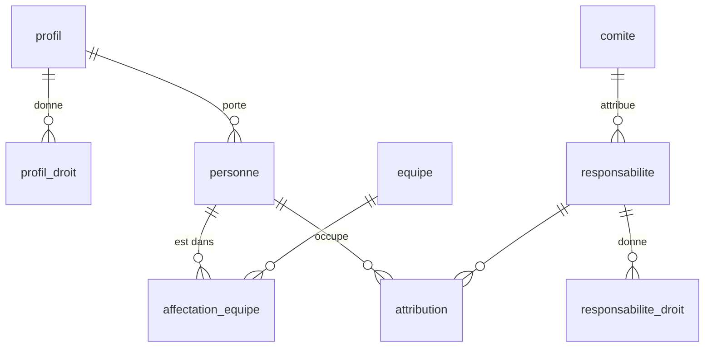

# Socle : tables et droits

Le paquet `packages/socle` porte la base (schéma Drizzle, migrations) et les actions protégées par les droits.

## Tables principales

| Table | Contenu |
|---|---|
| `personne` | Une adresse autorisée : nom, grade, profil, statut opérationnel |
| `profil`, `profil_droit` | Droits de base d'un type de personne (agent, réserve citoyenne…), chacun sur un périmètre |
| `equipe`, `affectation_equipe` | Équipes du centre et qui y est, avec dates |
| `responsabilite`, `responsabilite_droit` | Fonctions (chef de centre…) et missions (référent pharmacie…), avec leurs droits |
| `attribution` | Qui occupe quelle responsabilité, sur quel périmètre, de quand à quand |
| `comite` | Comités du centre ; un comité peut attribuer des responsabilités |
| `grade`, `champ_centre`, `valeur_champ` | Grades, et champs de fiche propres au centre |
| `journal` | Chaque action sensible : auteur, date, cible, détails |
| `user`, `session`, `account`, `verification` | Connexion (Better Auth, noms imposés) |
| `envoi_lien` | Dernier lien de connexion envoyé à chaque adresse (un par minute) |

Les dates sont des textes `AAAA-MM-JJ` ; une attribution ou une affectation est en cours si `debut <= date <= fin` (fin vide : sans fin).

## Droits

- Un **droit** (`GERER_ACCES`, `VOIR_PLANNING`…) est toujours accordé sur un **périmètre** : le centre, une équipe, un comité…
  Le centre couvre tous les périmètres ; sinon, il faut le même périmètre.
- Une personne tient ses droits de deux sources :
  - son **profil** ;
  - ses **attributions en cours**, chacune sur le type de périmètre de sa responsabilité.
- Une personne sans accès (suspendue, partie) n'a aucun droit. Le **super administrateur** (`SUPER_ADMINS`) a tous les droits sur le centre.
- Exceptions, sur le **code système** de la responsabilité (`responsabilite.systeme`) :
  - `chef_centre` : nommé ou retiré par un super administrateur seulement ;
  - `chef_centre_adjoint` (mêmes droits) : nommé ou retiré par le chef de centre en cours (`estChefDeCentre`) ou un super administrateur ; `ATTRIBUER_RESPONSABILITE` ne suffit pas ;
  - `chef_equipe` : responsabilité repérée, sans règle à part.
- `changerStatut` :
  - le statut du chef de centre en cours ne change que par un super administrateur ;
  - celui d'un adjoint en cours, que par le chef de centre en cours ou un super administrateur ;
  - « en cours » : un chef de centre nommé à l'avance n'est protégé qu'à partir de sa prise de fonction ;
  - quitter « suspendu » ou « parti » exige `GERER_ACCES` sur le centre ;
  - sans `GERER_ACCES` sur le centre, l'acteur ne touche qu'une personne sans attribution en cours ou à venir, dont il détient tous les droits du profil ;
  - vers « parti » : naissance et contact d'urgence effacés dans le même `batch` ; ils restent vides au retour.
- `modifierFiche` : `GERER_ACCES` sur le centre, et la même protection du chef de centre et des adjoints que `changerStatut` (messages propres à la fiche) :
  - seuls les champs changés sont écrits ; le journal (`modifier_fiche`) n'en garde que les noms, jamais les valeurs (un effacement au départ ne doit pas y survivre) ; rien de changé, rien d'écrit ;
  - l'adresse est normalisée et unique (« Adresse déjà utilisée ») ; la changer ferme, dans le même `batch`, les sessions et les liens en attente de l'ancienne. La ligne `user` de Better Auth garde l'ancienne adresse, qui ne se connecte plus (aucune fiche) ; la nouvelle crée son compte à la première connexion.
- `retirerEquipe` : `GERER_ACCES` sur le centre ; l'affectation en cours se termine la veille (effet le jour même), ou est supprimée si elle commence aujourd'hui ; les affectations à venir sont supprimées ; journal `retirer_equipe`.
- `ajouterPersonne` accepte aussi grade, date de grade, téléphone, naissance, entrée au centre et engagement SPV, dates vérifiées.
- `droitsDe(base, acteur, date)` liste les droits tenus ; `aLeDroit(base, acteur, droit, perimetre, date)` répond oui ou non. Toute action du socle commence par là et refuse avec `RefusDroit`, dont le message dit pourquoi quand le refus vient d'une des règles ci-dessus.
- Une action qui écrit plusieurs lignes (dont le journal) passe en un seul `batch` : tout ou rien.
