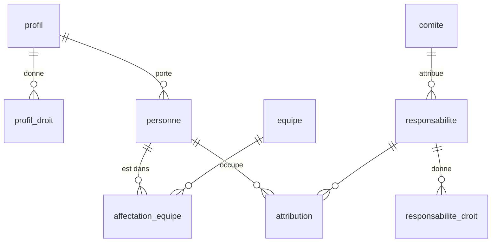

# Socle : tables et droits

Le paquet `packages/socle` porte la base (schéma Drizzle, migrations) et les actions protégées par les droits.

## Tables principales

| Table | Contenu |
|---|---|
| `personne` | Une adresse autorisée : nom, grade, profil, statut opérationnel |
| `profil`, `profil_droit` | Droits de base d'un type de personne (agent, réserve citoyenne…), chacun sur un périmètre |
| `equipe`, `affectation_equipe` | Équipes du centre et qui y est, avec dates |
| `responsabilite`, `responsabilite_droit` | Fonctions (chef de centre…) et missions (référent pharmacie…), avec leurs droits |
| `attribution` | Qui occupe quelle responsabilité, sur quel périmètre, de quand à quand |
| `comite` | Comités du centre ; un comité peut attribuer des responsabilités |
| `grade`, `champ_centre`, `valeur_champ` | Grades, et champs de fiche propres au centre |
| `journal` | Chaque action sensible : auteur, date, cible, détails |
| `user`, `session`, `account`, `verification` | Connexion (Better Auth, noms imposés) |

Les dates sont des textes `AAAA-MM-JJ` ; une attribution ou une affectation est en cours si `debut <= date <= fin` (fin vide : sans fin).

## Droits

- Un **droit** (`GERER_ACCES`, `VOIR_PLANNING`…) est toujours accordé sur un **périmètre** : le centre, une équipe, un comité…
  Le centre couvre tous les périmètres ; sinon, il faut le même périmètre.
- Une personne tient ses droits de deux sources :
  - son **profil** ;
  - ses **attributions en cours**, chacune sur le type de périmètre de sa responsabilité.
- Une personne sans accès (suspendue, partie) n'a aucun droit. Le **super administrateur** (`SUPER_ADMINS`) a tous les droits sur le centre.
- `droitsDe(base, acteur, date)` liste les droits tenus ; `aLeDroit(base, acteur, droit, perimetre, date)` répond oui ou non. Toute action du socle commence par là et refuse avec `RefusDroit`.
- Une action qui écrit plusieurs lignes (dont le journal) passe en un seul `batch` : tout ou rien.
