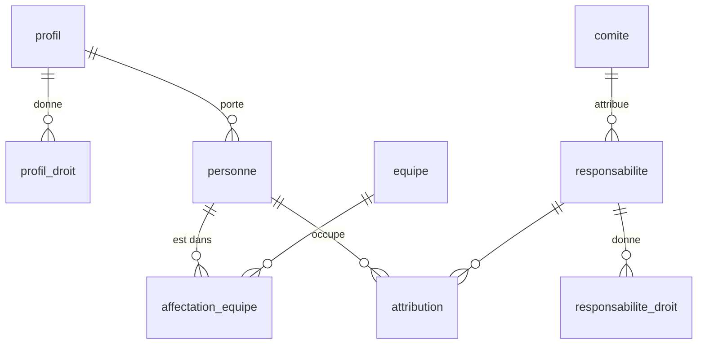

# Socle : tables et droits

Le paquet `packages/socle` porte la base (schéma Drizzle, migrations) et les actions protégées par les droits.

## Tables principales

| Table | Contenu |
|---|---|
| `personne` | Une adresse autorisée : nom, grade, profil, statut opérationnel ; `parti_le` (dernier départ, vide au retour), `efface_le` (données effacées) |
| `profil`, `profil_droit` | Droits de base d'un type de personne (agent, réserve citoyenne…), chacun sur un périmètre |
| `equipe`, `affectation_equipe` | Équipes du centre et qui y est, avec dates |
| `responsabilite`, `responsabilite_droit` | Fonctions (chef de centre…) et missions (référent pharmacie…), avec leurs droits ; `archivee_le` : date d'archivage, vide tant qu'elle sert ; `modele` : modèle d'origine (vide pour un rôle fait à la main) ; `icone` : icône choisie (vide : l'appli choisit) |
| `attribution` | Qui occupe quelle responsabilité, sur quel périmètre, de quand à quand |
| `comite` | Comités du centre ; un comité peut attribuer des responsabilités ; `dissous_le` : date de dissolution, vide tant qu'il existe |
| `grade`, `champ_centre`, `valeur_champ` | Grades, et champs de fiche propres au centre |
| `journal` | Chaque action sensible : auteur, date, cible, détails |
| `user`, `session`, `account`, `verification` | Connexion (Better Auth, noms imposés) |
| `envoi_lien` | Dernier lien de connexion envoyé à chaque adresse (un par minute) |

Les dates sont des textes `AAAA-MM-JJ` ; une attribution ou une affectation est en cours si `debut <= date <= fin` (fin vide : sans fin).

## Migrations

- Générées par `pnpm migrations` (drizzle-kit) dans `packages/socle/migrations/`, appliquées dans l'ordre.
- La préprod a des données : une migration publiée n'est jamais réécrite, une nouvelle n'efface ni ne transforme rien.
- Une donnée de départ ajoutée après coup va dans le jeu de départ (bases vides) **et** dans la migration, en insertion gardée qui ne joue que sur une base déjà remplie (`EXISTS profil`) et sans doublon (`NOT EXISTS`). Exemple : `0001` ajoute le « Référent technique ».
- **Un droit de plus** (`DROITS`) change le `CHECK` de `profil_droit` et `responsabilite_droit` : SQLite ne sait pas modifier un `CHECK`, il faut **reconstruire** les deux tables (première fois : `0022`, [décision 0025](../decisions/0025-droit-habillement-et-reconstruction.md)). Partir du SQL de drizzle-kit, puis à la main : retirer les `PRAGMA foreign_keys` (sans effet dans la transaction de D1, et inutiles : aucune table ne pointe vers ces deux-là), recopier le `rowid`, et écrire un test qui compare toutes les lignes et la forme des tables avant et après (`migration-0022.test.ts`, migration jouée comme D1 : clés étrangères actives, une transaction).

## Agents partis et effacement

[Décision 0029](../decisions/0029-effacement-des-agents-partis.md), [données des agents](../fonctionnel/donnees-des-agents.md). Migration `0025`, additive (`personne.parti_le`, `personne.efface_le`, sans valeur : un parti d'avant n'a pas de date et n'est pas effacé la nuit ; index `journal_cible` sur `journal(cible_type, cible_id)`).

- `changerStatut` pose `parti_le` au passage à « Parti » (pas s'il l'était déjà) et le vide à tout autre statut ; il refuse un agent effacé (`Agent effacé`), comme `modifierFiche`, `affecterEquipe` et les aptitudes. `gesteHabillement` ne prévient plus un demandeur parti.
- `partis.ts` :
  - `effacerAgentsPartis(base, limite, aujourdhui, adressesReservees)` (nuit, `limite` = `limiteDeConservation(quand, 12)`, `SUPER_ADMINS` du Worker) : statut « parti », `parti_le <= limite`, pas encore effacé ; 10 par nuit (`PARTIS_PAR_NUIT`), le reste la nuit suivante. Rien à faire : 1 requête ; sinon 2 lectures puis un `batch` par agent.
  - `effacerAgent(base, acteur, id, maintenant, adressesReservees)` (sur demande) : `GERER_ACCES` sur le centre ; refuse soi-même, une adresse de super administrateur, un agent pas parti (`Déclarez d’abord son départ`), déjà effacé.
  - `dateDEffacement(partiLe)` : un an après (le 1er mars pour un 29 février), affichée sur la fiche.
  - L'effacement, un `batch` : `personne` anonymisée (« Ancien » « agent », `efface-<id>@efface.invalid`, autres champs personnels vides, `profil_id` et `statut` gardés) ; `user` (sessions et comptes en cascade), `verification`, `envoi_lien` pour **toutes** ses adresses (l'actuelle et celles du journal, sauf une reprise par une autre fiche ou réservée à un super administrateur) ; `valeur_champ`, `aptitude_agent`, `cle_agenda`, `visite_mur`, `effacerNotificationsDe` (dont `envoi_push` en cascade) ; `details.email` retiré de ses lignes du journal ; une ligne `effacer_agent` (acteur `nuit`, ou l'auteur).
  - Gardé, sous « Ancien agent » : tout ce qui cite son identifiant (publications, messages, demandes, prises, anomalies, habillement, été, affectations, attributions). PHOTOS n'est pas touchée : aucune photo n'est à lui seul, et `personne.photo` n'est jamais remplie.
- Un effacé sort de `listeGestion`, de l'export et de l'import du fichier de l'effectif ; `ficheAgent` le lit toujours.
- Les copies chiffrées hebdomadaires sont gardées 3 mois : un effacement y disparaît au plus tard 3 mois après.

## Droits

- Un **droit** (`GERER_ACCES`, `VOIR_PLANNING`…) est toujours accordé sur un **périmètre** : le centre, une équipe, un comité…
  Le centre couvre tous les périmètres ; sinon, il faut le même périmètre.
- **Droits de pouvoir** (`DROITS_POUVOIR`, `estDroitPouvoir`) : `GERER_ACCES`, `ATTRIBUER_RESPONSABILITE`, `GERER_LISTES`, `GERER_COMITES`. Tous les autres sont des droits métier.
- **Droits du centre** (`DROITS_DU_CENTRE`, `estDroitDuCentre`) : `GERER_ACCES`, `GERER_LISTES`, `GERER_COMITES`, exigés sur le centre par les écrans (`personnes.ts` lit encore `GERER_ACCES` sur l'équipe d'une personne, pour un rôle ancien qui l'aurait). `creerResponsabilite` et `modifierResponsabilite` refusent (`DonneeInvalide('Droit réservé au centre')`) de les donner à une responsabilité d'équipe ou de comité : à la création, quand ils sont ajoutés, ou quand la portée change. Une responsabilité ancienne qui en porte déjà un sur une équipe reste modifiable pour le reste, sans correction silencieuse. Un profil ne donne aucun droit de pouvoir (`modifierDroitsProfil`). `ATTRIBUER_RESPONSABILITE` vaut sur toute portée (le rapporteur nomme dans son comité).
- **Droits sans effet** (`DROITS_SANS_EFFET`, `estSansEffet`) : `VOIR_MOTIFS_ABSENCE`, `VOIR_ANNUAIRE`. Gardés dans `DROITS` pour les lignes existantes, ils ne servent nulle part : l'appli ne les montre ni ne les propose (paquets, détail droit par droit, « Ce que ce rôle permet ») ; le détail droit par droit garde ceux déjà là.
- Une personne tient ses droits de deux sources :
  - son **profil** ;
  - ses **attributions en cours**, chacune sur le type de périmètre de sa responsabilité.
- Une personne sans accès (suspendue, partie) n'a aucun droit. Le **super administrateur** (`SUPER_ADMINS`) a tous les droits sur le centre.
- Exceptions, sur le **code système** de la responsabilité (`responsabilite.systeme`) :
  - `chef_centre` : nommé ou retiré par un super administrateur seulement ;
  - `chef_centre_adjoint` (mêmes droits) : nommé ou retiré par le chef de centre en cours (`estChefDeCentre`) ou un super administrateur ; `ATTRIBUER_RESPONSABILITE` ne suffit pas ;
  - `chef_centre` et `chef_centre_adjoint` portent `GERER_HABILLEMENT` (verrouillé) depuis `0022` ;
  - `chef_equipe` (« Chef de garde ») : responsabilité repérée. Depuis `0017`, elle porte aussi `TRAITER_ANOMALIE` et `GERER_FICHES` (sur son équipe) ; `gereLesEngins` donne la gestion des engins à tout chef de garde en cours.
- `changerStatut` :
  - le statut du chef de centre en cours ne change que par un super administrateur ;
  - celui d'un adjoint en cours, que par le chef de centre en cours ou un super administrateur ;
  - « en cours » : un chef de centre nommé à l'avance n'est protégé qu'à partir de sa prise de fonction ;
  - quitter « suspendu » ou « parti » exige `GERER_ACCES` sur le centre ;
  - sans `GERER_ACCES` sur le centre, l'acteur ne touche qu'une personne sans attribution en cours ou à venir, dont il détient tous les droits du profil ;
  - vers « parti » : naissance et contact d'urgence effacés dans le même `batch` ; ils restent vides au retour. La personne quitte aussi son équipe dans ce `batch`, avec la même logique que `retirerEquipe` (partagée) : affectation en cours terminée la veille ou supprimée si elle commence aujourd'hui, affectations à venir supprimées, journal `retirer_equipe` ; sans équipe, aucune erreur. Dans ce même `batch`, `finirOuSupprimer` sur toutes ses attributions (en cours : fin la veille ; commençant aujourd'hui ou plus tard : supprimées ; passées : gardées). Au retour, ni équipe ni rôle : il faut réaffecter et renommer.
- `modifierFiche` : `GERER_ACCES` sur le centre, et la même protection du chef de centre et des adjoints que `changerStatut` (messages propres à la fiche) :
  - seuls les champs changés sont écrits ; le journal (`modifier_fiche`) n'en garde que les noms, jamais les valeurs (un effacement au départ ne doit pas y survivre), sauf l'adresse : `details.email` porte `{ avant, apres }` ; rien de changé, rien d'écrit ;
  - l'adresse est normalisée et unique (« Adresse déjà utilisée ») ; la changer ferme, dans le même `batch`, les sessions et les liens en attente de l'ancienne. La ligne `user` de Better Auth garde l'ancienne adresse, qui ne se connecte plus (aucune fiche) ; la nouvelle crée son compte à la première connexion.
- `retirerEquipe` : `GERER_ACCES` sur le centre et la même protection du chef de centre et des adjoints ; l'affectation en cours se termine la veille (effet le jour même), ou est supprimée si elle commence aujourd'hui ; les affectations à venir sont supprimées ; journal `retirer_equipe`.
- `affecterEquipe` : `GERER_ACCES` sur le centre et la même protection du chef de centre et des adjoints ; même équipe que l'affectation ouverte → rien d'écrit ; même jour de début → l'équipe de cette affectation est corrigée ; sinon l'affectation ouverte se termine la veille du début ; journal `affecter_equipe`.
- `ajouterPersonne` accepte aussi grade, date de grade, téléphone, naissance, entrée au centre et engagement SPV, dates vérifiées, et un statut facultatif (« opérationnel » par défaut ; « parti » est refusé : « Statut impossible à la création »).
- Adresse réservée : `ajouterPersonne` et `modifierFiche` reçoivent la liste des super administrateurs (`adressesReservees`, obligatoire) et refusent leur adresse, normalisée, par `DonneeInvalide('Adresse réservée au super administrateur')`, avant toute écriture. `ajouterPersonne` ne la contrôle qu'après les droits : sans droit sur la cible, `RefusDroit`, et l'adresse ne se devine pas. Le formulaire web et le fichier de l'effectif passent par cette règle.
- Adresse unique, même en concurrence : si deux écritures passent le contrôle préalable, la contrainte UNIQUE de `personne.email` fait échouer la seconde ; `ajouterPersonne` et `modifierFiche` traduisent cette erreur en `DonneeInvalide('Adresse déjà utilisée')`.
- Longueurs maximales, refusées par `DonneeInvalide('<Champ> trop long')` dans `ajouterPersonne`, `modifierFiche` et `modifierMonProfil` : prénom, nom, surnom 60 ; téléphone 20 ; contact d'urgence 200 ; adresse 254 (« Adresse trop longue »). L'interface pose les mêmes bornes en `maxlength`.
- Côté écran, « Aucune équipe » appelle toujours `retirerEquipe` (qui retire aussi une affectation à venir) ; sans rien à retirer (« Aucune équipe en cours »), la page répond « Aucune équipe à retirer. ».
- Fin de période (`fin-de-periode.ts`, `finirOuSupprimer`) : règle commune aux équipes, aux dissolutions et aux archivages. Parmi les lignes visées encore ouvertes (fin vide ou ≥ aujourd'hui), celles commencées avant aujourd'hui se terminent la veille, les autres sont supprimées. Renvoie deux requêtes à placer dans le `batch` de l'action.
- Comités (`actions/comites.ts`), tous avec `GERER_COMITES` sur le centre :
  - `listerComites` (avec `estCentre`, `membresEnCours` et `rapporteurs` : qui tient, dans le comité, un rôle de portée comité non archivé portant `ATTRIBUER_RESPONSABILITE`, attribution en cours, personne présente), `creerComite`, `modifierComite` (seuls les champs changés ; journal sans valeurs), `dissoudreComite` ;
  - nom et thème : non vides, 60 caractères au plus ; nom unique parmi tous les comités, dissous compris, sans casse ni espaces de bord (« Nom déjà utilisé ») ;
  - le comité du centre, repéré par son nom (`NOM_COMITE_CENTRE`), ne se renomme pas et ne se dissout pas ; un comité dissous ne se modifie plus ;
  - `dissoudreComite` refuse (`DonneeInvalide('Changez d’abord qui attribue « nom »')`, rien d'écrit) tant qu'une responsabilité non archivée de portée « comité » a ce comité pour `comite_attributeur_id` ; sinon, en un `batch` : `finirOuSupprimer` sur les attributions dont le périmètre est ce comité, `comite_attributeur_id` remis à vide pour les responsabilités de centre ou d'équipe qu'il attribuait (le chef de centre attribue), `dissous_le` = aujourd'hui, journal `dissoudre_comite` avec `attributionsClose`.
- Responsabilités (`actions/responsabilites.ts`), toutes avec `GERER_LISTES` sur le centre :
  - `listerResponsabilites` (droits avec `verrouille`, `titulaires` en cours, `protegee`), `creerResponsabilite`, `modifierResponsabilite` (nom, nature, portée, attributeur, droits), `archiverResponsabilite` ;
  - « gère le pouvoir » : super administrateur ou `GERER_ACCES` sur le centre. Sans lui, refus (`RefusDroit` avec raison) d'ajouter ou de retirer un droit de pouvoir, et de modifier ou d'archiver une responsabilité qui en porte un (`protegee` côté liste) ;
  - attributeur (`Attributeur`) : `chef_centre` (portée centre ou équipe), `comite_vise` (portée comité seulement), `comite` + id (comité existant, non dissous). Stocké dans `comite_attributeur_id` : renseigné = ce comité ; vide et portée comité = le comité visé ; vide sinon = le chef de centre ;
  - nom unique parmi toutes les responsabilités, archivées comprises (même règle que les comités) ; nature et portée connues ; droits connus ;
  - la portée ne change pas pour une responsabilité système, ni tant qu'une attribution est en cours ou à venir ; un droit verrouillé ne se retire pas ; une responsabilité archivée ne se modifie plus ;
  - `archiverResponsabilite` : refusée pour une responsabilité système ; en un `batch` : `finirOuSupprimer` sur ses attributions, `archivee_le` = aujourd'hui, journal `archiver_responsabilite` avec `attributionsClose`.
- Modèles (`modeles.ts`, `MODELES`) : fixés par l'appli, chacun avec nom, nature, portée, icône et droits : Référent matériel, Référent pharmacie, Référent habillement, Référent technique, Membre de comité, Rapporteur de comité, Vierge. `creerResponsabilite` accepte `modele` (identifiant connu, sinon `DonneeInvalide('Modèle inconnu')`) et le garde ; sans icône choisie, il prend celle du modèle. Un modèle qui porte un droit de pouvoir suit la règle du pouvoir comme tout autre droit.
- Icônes (`icones.ts`) : `NOMS_ICONES` (les tracés sont dans l'appli, mêmes noms) et `iconeDuRole`, seule règle partagée par l'accueil et les réglages : l'icône choisie, sinon celle du modèle, sinon d'après le nom (engin, pharmacie, technique, habillement), sinon celle du thème (étoile pour chef de centre et adjoint, casque pour une portée équipe, groupe pour une portée comité, outil sinon). `modifierResponsabilite` refuse une icône inconnue (`Icône inconnue`).
- Profils (`actions/profils.ts`), réservés à qui « gère le pouvoir » (sinon `RefusDroit`) : `listerProfils` (droits sur le centre seulement) et `modifierDroitsProfil`, qui remplace les droits sur le centre d'un profil (les autres périmètres, comme un salon, ne bougent pas), refuse un droit de pouvoir (`Un profil ne donne pas de droit de pouvoir`), n'écrit rien sans changement, et journalise `modifier_droits_profil` avec `{ avant, apres }` dans le même `batch`.
- `attribuer` refuse une personne partie (`DonneeInvalide('Cette personne est partie')`), une responsabilité archivée et un périmètre « comité » dissous, et le doublon : même personne, même responsabilité, même périmètre, périodes qui se chevauchent (`DonneeInvalide('Cette personne tient déjà ce rôle sur cette période')`).
- Nominations (`actions/attributions.ts`). Une seule règle, `exigerAttribution`, dit qui attribue ou retire quoi ; les lectures s'en servent pour filtrer, sans la recopier :
  - `terminerAttribution` : mêmes droits que `finirAttribution` ; `finirOuSupprimer` sur cette attribution (perte du rôle aujourd'hui, annulation si elle commence aujourd'hui ou plus tard) ; refuse une attribution déjà terminée ; journal `terminer_attribution` avec `annulee` et `personneId` (la personne reste connue si l'attribution est supprimée) ;
  - `attributionsDe` (gestionnaires seulement) : les rôles d'une personne, en cours, à venir et passés, avec le nom du périmètre (équipe, comité ; rien pour le centre), l'auteur (« Prénom Nom » ou « Super administrateur ») et `peutTerminer` ;
  - `ceQueJePeuxAttribuer` : les responsabilités non archivées que l'acteur peut attribuer, avec leurs périmètres possibles (« Centre », équipes actives, comités non dissous) ; vide pour un agent ordinaire ;
  - `peutAttribuerQuelqueChose` : même règle, s'arrête au premier rôle attribuable (vrai d'emblée pour le super administrateur) ; sert au menu ;
  - `titulairesDe` : titulaires en cours et à venir d'une responsabilité, limités aux périmètres que l'acteur peut attribuer ;
  - `titulairesDesMiens` : la même chose pour toutes les responsabilités que l'acteur peut attribuer, ses droits lus une seule fois (page « Nominations »).
- `vueEffectif` (`effectif.ts`, vue de tous) : groupes par équipe active, puis « Sans équipe », « Extérieurs », « Partis », chacun avec une `cle` stable (`equipe:<id>`, `sans-equipe`, `exterieurs`, `partis`) ; chaque personne porte `roles`, ses rôles en cours triés (« Chef de garde (Équipe 1) » ; nom seul pour le centre), en une requête filtrée sur la date du jour ; ni dates ni auteur. Une responsabilité archivée ou un comité dissous n'y figure plus.
- `droitsDe(base, acteur, date)` liste les droits tenus ; `aLeDroit(base, acteur, droit, perimetre, date)` répond oui ou non. Deux copies en SQL, tenues égales par un test d'équivalence : `aLaMessagerie` (`messagerie.ts`) et `aLeDroitAuCentreSql` (un droit sur le centre, pour une colonne de requête : la pastille des envois). Toute action du socle commence par là et refuse avec `RefusDroit`, dont le message dit pourquoi quand le refus vient d'une des règles ci-dessus.
- Droits lus une fois par requête : `droitsDe` garde sa réponse par base (`WeakMap`, clé acteur + date) ; `hooks.server.ts` crée une base par requête HTTP, le cache ne vit donc qu'une requête. Toute requête qui n'est pas un `select` (insertion, mise à jour, suppression, `batch` qui en contient une) le vide avant de partir : `creerBaseD1` surveille `prepare` de D1, la base de test son propre envoi. Un échec de lecture n'est pas gardé. Budget D1 (50 requêtes par appel du Worker) : pour un chef de centre et 150 agents, `/agents/<id>` 28 requêtes, avec l'action `?/fiche` et le rechargement 40, `/reglages/roles/<id>` 20, `/nominations` 23, `/` 10, hors session (`apps/web/src/routes/budget.test.ts`, 45 au plus).
- Une action qui écrit plusieurs lignes (dont le journal) passe en un seul `batch` : tout ou rien.

## Murs

Règles fonctionnelles : [salons.md](../fonctionnel/salons.md). Migrations additives : `0003` (les murs), `0004` (`publication.sondage_ouverture`, `publication.sondage_cloture`), `0005` (`comite.icone`). `0006` refait `photo_publication` vide, sans octets, avec `photo_id` (données fictives de la préprod seulement).

| Table | Contenu |
|---|---|
| `publication` | Une publication d'un mur (`mur` : clé `centre`, `vie`, `equipe:<id>`, `comite:<id>`) ; auteur au format du journal (`personne:<id>` ou `super:<email>`) ; type, texte, prise de connaissance, épingle, commentaires fermés ; événement (`debut`, `lieu`, `convoques` en JSON) et sondage (question, réponses en JSON, `sondage_ouverture` et `sondage_cloture` à la minute, vides pour un sondage publié avant les dates : toujours ouvert) |
| `commentaire`, `jaime` | Fil de commentaires et « J'aime » |
| `reponse_evenement`, `vote_sondage`, `prise_connaissance` | Une ligne par personne et par publication |
| `photo_publication` | Les photos d'une publication (ordre, type, 4 au plus) ; `photo_id` renvoie à la base des photos |
| `visite_mur` | Dernière visite d'une personne sur un mur (nouveautés) |
| `comite.icone` | Icône du mur du comité, parmi `NOMS_ICONES` ; vide : celle du thème |
| `personne.anniversaire_visible` | 1 par défaut ; 0 : l'anniversaire n'est pas affiché |

Supprimer une publication supprime ses lignes liées (`ON DELETE CASCADE`).

### Base des photos

Une base D1 à part (liaison `PHOTOS`, `creerBasePhotos`, `locals.basePhotos`), car une base gratuite tient 500 Mo : voir [0010](../decisions/0010-photos-dans-leur-base.md). Schéma `src/schema-photos.ts`, migrations `migrations-photos/` (`pnpm --filter @gyro-caserne/socle migrations-photos`). Une seule table, `photo` : `type` (JPEG ou WebP), `donnees` (les octets, 200 Ko au plus), `taille` (en octets), `cree_le`. Aucun lien vérifiable d'une base à l'autre : c'est le socle qui tient les deux ensemble.

- `publier` écrit les octets en un `batch` (qui rend les identifiants), puis la publication et ses `photo_publication` en un `batch` ; si ce second `batch` échoue, les octets sont effacés et l'erreur d'origine remonte.
- `supprimerPublication` supprime dans la base principale, puis les octets ; si cet effacement échoue, ils restent orphelins, sans erreur pour l'agent.
- `photo` vérifie l'accès dans la base principale, puis lit les octets.
- `remplissagePhotos` : la somme des `taille` en une requête, sur 500 Mo, `alerte` à partir de 80 %. Affichée sur la page Réglages (chef de centre, adjoint, super administrateur).
- La base de test (`test/base-de-test.ts`) a la base des photos dans `base.photos` ; `base.requetes` compte les deux bases (budget D1).

- `murs.ts` : `mursEtAppartenances` (et `mursDe`) déduit les murs d'un acteur et ses droits (`peutPublier`, `peutModerer`, `lectureSeule`) de son appartenance du jour, en **un `batch`** : fiche et profil, rôles tenus, affectations, équipes, comités. Aucun droit enregistré par mur. `exigerMur` / `accesMur` refusent par `RefusDroit` (`LIRE_SALON`, `PUBLIER_SALON`, `MODERER_SALON`). `estMembre` et `estConvoque` : qui est attendu dans un suivi, qui est convoqué. `lecturesAgents` (lectures à mettre dans un `batch`), `agentsDuJour` et `membresDe` : les agents du jour avec leurs appartenances, et les membres d'un mur ; `audiences` : le nombre de membres de plusieurs murs en une requête (« Visible par … »).
- `qui-fait-quoi.ts` : `quiFaitQuoi`, la page « Comités et référents » : comités en cours (membres du jour et leur rôle court, lien du mur selon la règle de `mursDe`, matériel du comité que l'acteur voit dans Réservations), chef de centre et adjoint, rôles de portée équipe par équipe active, référents ; titulaires parmi les agents qui ont accès (`lecturesAgents`), chacun `{ id, nom, ecrire }` : `ecrire` si l'acteur et lui ont la messagerie (`aLaMessagerie`, une lecture de plus dans le même batch) et que ce n'est pas lui. **Un `batch`**, plus `droitsDe` (déjà en cache dans une requête). `RefusDroit` pour qui n'est ni agent avec accès ni super administrateur ; `ouvreQuiFaitQuoi`, la même règle en une requête, pour le lien de Caserne.
- `icones.ts` : `iconeDuComite` donne l'icône choisie, sinon celle du thème (`coeur` pour « amicale », `etoile` pour « centre », `groupe` sinon).
- `apercus.ts` : `apercusDesMurs` (2 requêtes au plus) donne pour chaque mur son identité (icône, couleur et numéro d'équipe), si l'acteur en est membre, et sa dernière publication (auteur, début du texte sur une ligne, date).
- `commun.ts` : `texte` (texte obligatoire, longueur maximale) et `roleDe` (premier rôle tenu), partagés par les murs et la messagerie ; pour les photos, `exigerPhotos` (4 au plus, JPEG ou WebP vérifiés à leurs premiers octets, 200 Ko chacune), `avecPhotos` (octets d'abord, puis les références ; effacés si elles échouent), `effacerPhotos` (par paquets de 100, échec ignoré : octets orphelins) et `lireOctets`.
- `actions/publications.ts` : `publier` (types, prise de connaissance réservée aux modérateurs, photos JPEG ou WebP, sondage 2 à 6 réponses avec clôture obligatoire, après l'ouverture, à moins d'un an et pas après le début de l'événement, événement à venir ; octets dans la base des photos, puis publication, journal et références en un `batch`), `modifierPublication`, `supprimerPublication` (journal sans le contenu), `epingler`, `fermerCommentaires`, `lireMur` (épinglées puis 20 publications par page, 30 au plus, avec leurs 2 derniers commentaires ; note la visite ; donne l'audience du mur, `sienne` (mur d'équipe de l'acteur : membre ou chef de garde de cette équipe) et, pour chaque publication, le visage de l'auteur — couleur d'équipe, rôle —, les présents d'un événement et le compte « faites sur attendues » d'une annonce), `lirePublication` (sans noter la visite), `textePublication` (le texte seul, si l'acteur lit le mur : « Répondre en privé » ; 2 requêtes), `photo` (vérifie que l'acteur lit le mur), `remplissagePhotos`.
- `actions/interactions.ts` : `commenter`, `supprimerCommentaire`, `lireCommentaires`, `aimer`, `repondreEvenement` (convoqués seulement, refusé dès le début : « Cet événement est passé »), `voter` (refusé avant l'ouverture et dès la clôture, `etatSondage` : à la minute), `prendreConnaissance`, `suiviPublication` (qui a pris connaissance et qui pas encore ; présents, absents, incertains, sans réponse). Le super administrateur, sans fiche, n'aime, ne répond ni ne vote.
- `a-ne-pas-manquer.ts` : `aNePasManquer` (2 requêtes : les murs, puis un `batch` de lectures) donne annonces à prendre en compte (90 derniers jours), événements à venir ou en cours où l'acteur est convoqué (`enCours` : jusqu'à `publication.fin`, sinon 3 h ; `momentEvenement` et `debutMinimumEvenement` de `dates.ts`), sondages ouverts, épinglées récentes (30 jours) et nouveautés par mur (depuis la dernière visite, 14 jours sans visite) ; seulement les murs dont il est membre, hors lecture seule. `anniversairesDuJour` : jour et mois de Paris, jamais l'âge ; avec le geste de l'acteur (`souhaiter`, `souhaite`, ou rien pour lui-même et le super administrateur). `monAnniversaire` : nul, ou les collègues qui l'ont souhaité (un `batch`).
- Limites D1 tenues : une ligne fait 2 Mo au plus (photo à 200 Ko, envoi limité en amont, voir [interface.md](interface.md)) ; 50 requêtes par appel (pages et gestes des murs à 45 au plus, `budget.test.ts`) ; jamais deux colonnes de même nom issues de tables jointes dans un même `batch`.

## Messagerie

Spec : [2026-10-29-messagerie-design.md](../superpowers/specs/2026-10-29-messagerie-design.md). Migrations additives `0007`, `0008` (réactions, photos), `0009` (signalements, `lu_le`).

| Table | Contenu |
|---|---|
| `conversation` | `type` (`deux` ou `groupe`), nom et icône (groupe), `cle_paire` unique « petit id:grand id » (une conversation à deux par paire), créateur, `cree_le`, `dernier_le` (tri de la liste) |
| `membre_conversation` | Un membre : `animateur`, `entre_le`, `lu_jusqu_a` (id du dernier message lu) |
| `message` | Auteur (nul pour un message système), texte, `reponse_a`, `systeme`, `cree_le`, `maj_le` (rafraîchissement), `lu_le` (lu par un autre : la coche de l'auteur peut changer), `modifie`, `supprime` (`auteur` ou `moderation`) ; index `(conversation_id, id)` et `(conversation_id, maj_le)` |
| `reaction_message` | Une réaction par personne et par message (clé `(message_id, personne_id)`), parmi `REACTIONS` : 👍 ❤️ 😂 😮 😢 👏 |
| `photo_message` | Les photos d'un message (ordre, type, 4 au plus) ; `photo_id` renvoie à la base des photos |
| `signalement_message` | Un signalement : `message_id` (nul une fois le message effacé), `par`, `le`, `auteur`, `envoye_le`, copie du texte et des identifiants de photos (`photos_copie`, JSON), `classe_le` ; unique par `(message_id, par)` |
| `personne.coches_lecture` | 1 par défaut ; 0 : ne montre plus ses lectures et ne voit plus celles des autres (`modifierMonProfil({ cochesLecture })`) |

- `messagerie.ts` : une seule règle d'accès, `aLaMessagerie` (SQL) : agent ni parti, ni suspendu, ni extérieur, avec `UTILISER_MESSAGERIE` sur le centre (profil ou responsabilité en cours, même calcul que `droitsDe`). `exigerMessagerie` l'applique à l'acteur (`RefusDroit` sinon, super administrateur compris). Seuls les membres lisent une conversation, chef de centre compris.
- `annuaire` (1 requête) ; `conversationAvec` (1) ; `envoyer` (2, 3 avec photos ; sans texte, au moins une photo ; octets écrits d'abord dans PHOTOS, comme pour les murs) : la conversation à deux naît au premier envoi, en un `batch` avec ses membres et le journal `creer_conversation` (sans texte ni nom) ; si l'autre l'a créée entre-temps, l'unicité de `cle_paire` fait échouer ce `batch` et l'envoi rejoint l'existante. L'autre parti ou suspendu : conversation en lecture seule.
- `lireConversation` (2 au plus) : 40 messages par page (`avant` : id), avec leurs réactions et identifiants de photos, `premierNonLu`, `lectureSeule`, coches ; marque l'acteur comme ayant lu jusqu'au dernier message de la dernière page. `mesConversations` (1) et `nonLusTotal` (1) : non-lus = messages des autres, ni système ni supprimés, après `lu_jusqu_a`. Aperçu d'un message sans texte : « Photo ».
- **Coches** de mes messages : `lu` dans une conversation à deux si l'autre l'a lu ; dans un groupe, si tous les membres présents à l'envoi (`entre_le`) qui ont leurs coches l'ont lu ; sinon `envoye` (aussi quand personne ne compte) ; aucune (`null`) si l'acteur a coupé les siennes.
- **Gestes** (1 requête de contrôles, 1 d'écriture ; membres seulement) : `reagir` (une par personne ; la même, ou `null`, la retire ; pas sur un message supprimé ou système) ; `modifierMessage` (l'auteur, 15 minutes après l'envoi au plus, `modifie` à 1) ; `supprimerMessage` (l'auteur ; texte vidé, `supprime` = `auteur`, réactions et photos effacées, octets compris). Chaque geste avance `maj_le` (rafraîchissement). En lecture seule, on ne réagit ni ne modifie plus, mais on supprime encore. `photoMessage` (1 requête, puis les octets) : aux membres seulement.
- **Groupes** : `creerGroupe` (2 requêtes ; nom 1 à 60 caractères, icône de `NOMS_ICONES`, 2 à 60 membres de l'annuaire, créateur animateur, journal `creer_conversation`). Animateurs seulement : `ajouterMembres`, `retirerMembre`, `nommerAnimateur` ; tout membre : `renommerGroupe`, `quitterGroupe`. Chaque geste : 1 requête de contrôles, 1 `batch` d'écritures. Le nouvel arrivant voit l'historique, sans non-lus (`lu_jusqu_a` posé au dernier message). Un membre retiré ou parti perd tout l'accès. Sans animateur, le plus ancien membre (puis le plus petit id) le devient ; sans membre, le groupe est effacé avec ses messages, réactions et photos (octets compris). `changerStatut(base, basePhotos, …, 'parti', maintenant)` fait quitter tous les groupes (`departDesGroupes`) ; il reçoit pour cela `maintenant` (date et heure), et la base des photos pour un groupe dont l'agent était le dernier membre ; de même `appliquerOperation` et `quitterGroupe`.
- **Messages système** : `message.systeme` en JSON, `{ type, par?, cibles?, membres?, nom? }` (`creation`, `ajout`, `retrait`, `depart`, `renommage`, `animateur` ; sans `par` : relais automatique). `phraseSysteme(systeme, prénoms)` en fait la phrase (« Romain a ajouté Manon et Claire »), dans l'aperçu et dans `VueMessage.systeme`. Les prénoms cités sont lus par `json_tree`, dans la même requête.
- **Rafraîchissement** : `suiteConversation(base, acteur, id, { dernierId, majLe }, maintenant)` (1 requête, 2 s'il y a du nouveau à marquer lu) rend `nouveaux` (après `dernierId`, 40 au plus, les plus anciens d'abord), `modifies` (avant, avec `maj_le` ou, pour mes messages, `lu_le` après `majLe`), le repère suivant `majLe` et `nonLusTotal`. Le repère (`majLe`, aussi rendu par `lireConversation`) part 10 secondes avant maintenant : une écriture finie juste après la lecture n'est pas perdue, au prix d'un message parfois renvoyé deux fois. Membre retiré : `RefusDroit` ; repère de plus d'une heure : `DonneeInvalide('Repère trop ancien')` (la route répond 409, la page recharge la conversation). Le message cité porte `supprime` : sans texte ni suppression, c'est une photo. Lire (`lireConversation`, `suiteConversation`, `envoyer`) avance `lu_le` des messages découverts, sauf coches coupées.
- **Signalements** : `signaler` (2 requêtes ; un membre, une fois, pas son propre message, ni un message système ou supprimé ; journal `signaler_message`). La copie garde le texte et les photos : `supprimerMessage`, un groupe vidé et `effacerAnciens` n'effacent pas les octets d'une photo copiée par un signalement non classé. `MODERER_MESSAGERIE` seulement : `signalements` (non classés : auteur, date d'envoi, qui a signalé, texte et photos copiés, `retirable`, rien d'autre de la conversation), `nombreSignalements` (pour la cloche : le compte des non classés, 0 pour qui ne modère pas ; les droits puis 1 requête, sans lire les copies), `retirerParModeration` (`supprime` = `moderation`, réactions et photos effacées, signalements du message classés ; journal `retirer_message`), `classerSignalement` (copie effacée, octets aussi si plus rien ne les montre ; journal `classer_signalement`), `photoSignalee` (une photo de la copie d'un signalement non classé, identifiant dans PHOTOS ; 1 requête de droits, 1 de contrôle, puis les octets). Jamais de texte au journal.
- **Conservation** : `effacerAnciens(base, basePhotos, avant)` efface les messages créés avant `avant` (réactions, photos et octets compris) et les signalements classés d'avant cette date ; les conversations restent. Appelé chaque nuit par le gestionnaire planifié du worker (`apps/web/src/planifie.ts`), avec `conservationMessagesMois` du centre (12 par défaut).
- **Conservation des publications** : `effacerVieillesPublications(base, basePhotos, avant)` efface les publications créées avant `avant`, sauf épinglées et événements datés après `avant` ; leurs dépendances partent en cascade (`commentaire`, `jaime`, `reponse_evenement`, `vote_sondage`, `prise_connaissance`, `photo_publication`, `notification` ; `manoeuvre.publication_id` passe à nul), puis les octets dans PHOTOS. Par lots de 100, 5 au plus par nuit. Même gestionnaire, avec `conservationPublicationsMois` (24 par défaut) ; voir [0023](../decisions/0023-conservation-des-publications.md).
- **Photos orphelines** : `effacerPhotosOrphelines(base, basePhotos, maintenant)` (`photos-orphelines.ts`, même gestionnaire de nuit) efface les octets de PHOTOS que plus rien ne référence, quand un `effacerPhotos` a échoué. Références : `photo_publication`, `photo_message`, `anomalie.photo_id`, les écarts de `prise_garde.saisie` (JSON, toute prise) et `signalement_message.photos_copie` des signalements non classés, et l'écusson du centre (`ecusson.photo_id`) (`personne.photo`, texte jamais rempli, n'en est pas une). Sans jointure possible d'une base à l'autre : chaque nuit examine une tranche de 200 identifiants (tranche = numéro du jour modulo le nombre de tranches jusqu'au plus grand identifiant), toutes en à peu près autant de nuits que de tranches (environ 13 pour 2 500 photos ; un peu plus quand le nombre de tranches change). Une photo créée depuis la veille à minuit est gardée (envoi en cours). Coût : 1 requête si PHOTOS est vide, 2 si la tranche est vide, 3 sans orpheline, 4 avec (un `batch` de 6 lectures dans la base principale ; elles parcourent `photo_publication`, `photo_message`, `anomalie`, `prise_garde` et `signalement_message`, sans index sur `photo_id`, quelques milliers de lignes lues par nuit).
- **Écusson du centre** (`ecusson.ts`) : la table `ecusson` (une ligne, migration additive `0024`) garde `photo_id`, l'image dans PHOTOS, qui sert de version. `deposerEcusson` et `retirerEcusson` (droit `GERER_LISTES` sur le centre, journalisés) effacent l'ancienne image ; `octetsEcusson` ne sert que l'image en place ; `enTeteDe` lit la version dans son `batch` (le super administrateur : une petite lecture). Voir la [décision 0027](../decisions/0027-ecusson-du-centre.md).
- **Index de la conservation** (migration additive `0021`) : `publication (epinglee, cree_le)`, `message (cree_le)` et `manoeuvre (publication_id)` (l'effacement d'une publication y remet l'annonce à nul). Sans eux, chaque nuit parcourt toutes les publications, tous les messages, et toutes les manœuvres pour chaque publication effacée. Vérifié par le plan de SQLite (`base.plan`, `EXPLAIN QUERY PLAN`) dans les tests : sur `cree_le` seul, SQLite préfère parcourir la table dans l'ordre des identifiants.
- `infosConversation` (1) : type, nom, icône, créateur (`creeParPrenom`, même parti du groupe), membres triés par nom (équipe, rôle, animateur, téléphone s'il le montre), `moiAnimateur`. Sur un mur, `PublicationVue.auteur.ecrireA` donne l'auteur à qui « Répondre en privé » (il a la messagerie, et ce n'est pas l'acteur), par la même règle `aLaMessagerie`. `membresPourGroupe` (1) : membres du jour d'une équipe ou d'un comité (`membresDe` des murs), qui ont la messagerie, sans l'acteur.

## Notifications

Spec : [2026-10-31-notifications-design.md](../superpowers/specs/2026-10-31-notifications-design.md). Migrations additives `0010` et `0020` (réservation des envois : `jeton`, `reservee_le`, `essais`). Décision : [0012](../decisions/0012-notifications-file-d-envoi.md).

- `marquerLue` (une ligne de la cloche, par son genre et son identifiant, la sienne seulement ; 1 requête, aucune pour le super administrateur ; genre inconnu refusé) : ouvrir une ligne depuis la cloche, quelle que soit sa page.
- Tables : `notification` (le fil de la cloche : personne, publication, commentaire éventuel, `lue_le` ; supprimée avec sa publication ou son commentaire), `abonnement_push` (un appareil, `endpoint` unique : réabonné, il passe au dernier agent), `coupure` (`tout`, `mur:<clé>` ou `conversation:<id>`), `envoi_push` (la file, `donnees` en JSON : titre, texte, url, tag ; `jeton`, `reservee_le` en UTC et `essais` pour la réservation d'un lot).
- `notifierPublication`, `notifierCommentaire`, `notifierMessage` (1 lecture + 1 écriture) : destinataires du moment (lecteurs du mur par `lecturesAgents` ; auteur de la publication s'il lit encore le mur ; membres qui ont la messagerie), jamais l'auteur ; le fil (pas pour les messages) et la file, sans les appareils coupés. Listes d'identifiants passées en un seul paramètre JSON (`json_each`) : sous les 100 paramètres de D1, même à 150 agents.
- `filDeNotifications` (1) : 50 lignes, non-lues ; `enTeteDe` (1) : non-lues, visage et version de l'écusson du centre (dans le même `batch`) ; le super administrateur : l'écusson seul (1). `lireMur` marque lues les publications du mur, `lirePublication` la publication et ses commentaires, `demandeVue` les avis de la demande (pour l'acteur), `eteAPreparer` les avis d'été de l'acteur qui mènent à `/planning/ete`, dans leur batch (sans aller-retour de plus) ; `toutMarquerLu`.
- `couper`, `estCoupe`, `mesNotifications` (1) ; `abonner` (services push connus seulement : Google, Mozilla, Apple, Microsoft, pour que le Worker ne poste jamais ailleurs ; dix appareils au plus par agent ; un appareil repris perd les envois en file de l'ancien titulaire), `desabonner`.
- `prendreEnvois(base, max, maintenant, ici)` (1 batch : abandonne les envois coupés `ESSAIS_MAX` = 3 fois, réserve les plus anciens libres sous un `jeton` et les lit, avec, pour chaque personne du lot, `pastille` : le chiffre de la cloche — non-lues, remplacements à valider (`aValiderPar`), signalements, réservations à trancher (`aTrancherPar`) — plus ses messages non lus (`nonLusPour`), calculés en SQL dans la même requête ; libre = jamais réservé, ou réservé il y a `REPRISE_MINUTES` = 5 minutes ou plus, donc coupé en route ; jamais pris par deux lots à la fois) et `finirEnvois(base, jeton, perimes)` (1 requête : retire le lot parti, reçu ou refusé, et les abonnements en 404/410), pour `envoyerLot` de l'appli (20 s au plus par appel au service push ; un envoi repris, `essais` > 1, part sans `Topic` ; la charge porte le numéro de l'envoi et la pastille, lus par le service worker ; un avis d'été, d'anomalie ou d'habillement, retrouvé par `mettreEnFile(…, ligne)`, fait passer l'adresse par `/notifications/ouvrir`) ([décision 0012](../decisions/0012-notifications-file-d-envoi.md)). `creerBaseD1(d1, siEnFile)` prévient quand une requête met des envois en file (`insert into "envoi_push"`) : `hooks.server.ts` envoie alors un lot de 20 après la réponse (`envoyerApres`), sans aucune requête de plus sinon ; la base de test le note dans `misEnFile`. `effacerVieillesNotifications` (ménage de nuit). Au départ (`changerStatut` → `parti`), abonnements, fil (avis de réservation compris) et coupures sont effacés.

## Réservations

Spec : [2026-10-31-reservations-design.md](../superpowers/specs/2026-10-31-reservations-design.md). Migration additive `0011` (tables, puis à la main : la VL gérée par « Référent engins » et `RESERVER` pour les profils « Agent » et « Réserve citoyenne », insertions gardées comme `0001`).

| Table | Contenu |
|---|---|
| `ressource` | Nom, `forme` (`jours` avec un `stock`, ou `creneau` sans stock), icône, `ouverte_reserve`, gérée par **un** rôle (`geree_par_responsabilite_id`) **ou** un comité (`geree_par_comite_id`), `retiree_le` |
| `reservation` | Ressource, personne (le compte), `nom_demandeur` et `telephone` (réserve citoyenne), `debut`, `fin` (jours `AAAA-MM-JJ` inclus ; créneau `AAAA-MM-JJTHH:MM`, fin exclue), `quantite`, `mot`, `etat` (`attente`, `acceptee`, `refusee`, `annulee`), `tranchee_par`, `tranchee_le`, `motif` |
| `avis_reservation` | Ce que le demandeur apprend (accord, refus, annulation) : sa ligne dans la cloche, `lue_le` |

- `reservations-calcul.ts` (pur, partagé avec l'écran Réserver) : `chevauche`, `restantParJour` (attente et acceptée comptent), `periodeCourte`.
- `reservations.ts` : une seule règle de gestion, `gere` (SQL, dans `reservations-gestion.ts` avec `aTrancherPar`, le nombre à trancher, repris par la pastille des envois) : la personne a accès et tient aujourd'hui le rôle gestionnaire, ou un rôle de portée comité dans le comité gestionnaire (non dissous, rôle non archivé) ; le super administrateur gère tout. Réserver exige `RESERVER` sur la ressource (le centre la couvre) ; un profil extérieur (réserve citoyenne) ne voit et ne réserve que les ressources ouvertes, nom du demandeur obligatoire.
- `reserver` (créneau libre : acceptée ; sinon en attente, décidé dans l'écriture même par un `CASE WHEN EXISTS`, pour que deux demandes simultanées ne soient pas toutes deux acceptées ; jours : en attente, refus si le stock manque), `accepter` (VL : annule les acceptées qui chevauchent ; matériel : revérifie le stock), `refuser`, `annuler` (le demandeur avant le début ; qui gère, une réservation en cours de validité), `ajouterRessource` (pour un comité de l'acteur), `modifierRessource` (le stock ne descend pas sous ce qui est accepté un jour à venir), `retirerRessource` (annule les réservations à venir), `annulerAuDepart` (dans le batch de `changerStatut` → `parti`). Chaque action et son journal en un `batch`, avec les avis et la mise en file des envois au téléphone (lieu `reservations` : seul « tout » le coupe ; jamais à qui tranche sa propre demande ; avis et envoi conditionnés à la décision réellement écrite : deux gestionnaires qui tranchent en même temps ne font pas deux avis contradictoires).
- Lectures : `ressourcesDe`, `calendrier`, `mesReservations` (marque lus les avis), `aValider`, `acceptees`, `nombreAValider` (1 requête : la cloche), `ressourcesAGerer`. Une demande dont la période est passée ne compte plus à valider. Les casquettes d'un rôle ou d'un comité gestionnaire comptent leurs demandes (« À décider »). « Le centre » y ajoute l'été (à ouvrir, plages à revoir par `plagesARevoir`, à publier) : deux lectures de plus seulement si l'été est proposé et non publié.
- `effacerVieillesReservations` : ménage de nuit, réservations finies depuis plus d'un an. `chargerMaterielFictif` : bancs, tables, barnum de l'amicale, pour les comptes de test et le développement local.

## Planning de l'année

Spec : [2026-11-01-planning-annee-design.md](../superpowers/specs/2026-11-01-planning-annee-design.md). Migration additive `0012`. Décision : [0013](../decisions/0013-planning-de-l-annee.md). Dossier `src/planning/`.

- Tables : `annee_planning` (année, `ordre` du roulement en JSON, `publiee_le`), `semaine_changee` (jour de relève, équipe), `manoeuvre` (début, fin (vide : 3 h), thème, lieu, convoqués en JSON, petit-déjeuner, `annulee_le`, `publication_id`, `relance_le`), `vacances_scolaires`, `garde_fete` (historique saisi : année, `noel` ou `nouvel_an`, équipe), `cle_agenda` (personne, clé secrète) ; colonnes `publication.annulee_le` et `publication.fin`.
- `calendrier.ts` (sans base) : `feries`, `semainesDe`, `periodesDeLaSemaine` (heures réelles d'après `astreinte.semaine`), `calculerAnnee` (`entre` : seulement les semaines qui commencent dans cette période), `equipeA`, `fetes`, `tourDesFetes`.
- `annee.ts` : `preparerAnnee` et les actions du chef (`GERER_PLANNING`, une ligne de journal chacune) ; `planningDe` pour l'agent (`VOIR_PLANNING`) : équipe de l'agent à la date de chaque relève, prochaine astreinte, manœuvre (encore là jusqu'à sa fin, `enCours`) et fête. Les années lues ne sont calculées qu'à la demande, une fois chacune : l'année affichée, puis, pour la prochaine astreinte et la prochaine fête, les années à venir jusqu'à trouver (rien à chercher pour qui n'a ni équipe ni renfort à venir). Changer ou annuler une manœuvre annoncée met sa publication à jour dans le même batch.
- `suivante.ts` : « Partir d'une proposition » (`GERER_PLANNING`). `proposerAnnee` calcule sans écrire ; `accepterProposition` écrit roulement, semaines changées et manœuvres en un seul `batch`, une écriture par ligne (limite de D1). Une insertion simple dans `annee_planning` fait échouer tout le bloc si une autre acceptation est passée : l'année n'est jamais écrasée. Calculs purs testés seuls : `ordreQuiContinue`, `reglerFetes` (au plus deux échanges touchant une semaine de fête, le coût le plus bas gagne), `memePlaceDansLeMois`, `periodeDuTour`, `reprendreManoeuvres`. Pas de migration.
- `manoeuvres.ts` : `planningDuMatin` (appelé à 8 h et 8 h 10 par `planifie.ts`) annonce à 14 jours ou moins (avec les choix du petit-déjeuner du centre) et relance le mercredi ; `manoeuvreChangee` prévient les convoqués (`notifierConvoques` dans `notifications.ts`). Auteur `planning`, affiché « Planning du centre ».
- `agenda.ts` : `monLienAgenda`, `changerLienAgenda`, `agendaDe` (iCalendar, UTC, lignes pliées à 75 octets). Le décalage de Paris est lu deux fois par jour au plus puis gardé (les jours de changement d'heure, l'heure est cherchée pas à pas, comme avant) ; une ligne courte en ASCII n'est pas découpée. Le fichier reste identique octet pour octet (`agenda-octets.test.ts`, qui garde l'ancien calcul pour référence). La clé est effacée au départ de l'agent.
- `fictif.ts` : `chargerPlanningFictif`, pour le jeu de départ local et la préprod ; `chargerEteFictif` : l'été qui vient (celui de l'an prochain à partir de septembre), ouvert, avec un équipage fictif de six agents par équipe, des vacances et des réponses, proposé si l'année a son roulement. Le FPT est armé presque partout ; du lundi au jeudi de la 6e semaine, tous les CA tout engins sont en vacances : quatre plages à revoir. Rien si cet été est déjà ouvert.

## Remplacements et aptitudes

Spec : [2026-11-01-remplacements-design.md](../superpowers/specs/2026-11-01-remplacements-design.md). Migration additive `0013` (aptitudes par défaut ajoutées à la main pour les bases déjà remplies, une instruction par aptitude : D1 refuse les SELECT composés de plus de cinq termes). Décision : [0014](../decisions/0014-remplacements.md).

- Tables : `aptitude` (nom unique, `controlee`, ordre, `retiree_le`), `aptitude_agent` (personne, aptitude, `obtenue_le`, `expire_le`), `demande_remplacement` (genre, demandeur, cible, `periodes` et `periodes_cible` en JSON, manœuvres, équipe qui valide, `debut`, état, remplaçant, `manque`, dates), `destinataire_remplacement` (demande, personne, `refuse_le`), `avis_remplacement` (la cloche).
- `aptitudes.ts` : liste du centre (`GERER_LISTES`), aptitudes d'un agent (`GERER_ACCES`, ou soi-même), `validesLe`.
- `remplacements/tranches.ts` : calculs purs (tranches, soustraction, textes). `contexte.ts` : une lecture en un batch (semaines publiées, affectations, demandes en cours, agents, aptitudes, chefs) et les règles sans requête (`disponible`, `manque`, `valideurs`, `mesTranches`). Les semaines d'astreinte d'une personne (`astreintesDe`) sont calculées une fois par contexte, donc par requête, puis reprises (`ctx.astreintes`) : un échange compare chaque collègue à chaque tranche, et les recalculer coupait la page (erreur 1102, [décision 0021](../decisions/0021-calcul-et-reprises.md)). De même, une fois par requête : les engagements des demandes en cours, par personne (`ctx.engages`, lus par `sansEngagement`) ; les heures d'astreinte à plat et triées (`ctx.heures`), où `dAstreinte` cherche par moitiés au lieu de parcourir l'année. `pourDemander` garde les semaines de chaque collègue pour le collègue choisi. Les semaines publiées du contexte (`ctx.semaines`) ne sont calculées qu'au premier usage, et seulement celles qui commencent dans la fenêtre des remplacements (15 jours avant aujourd'hui, 13 semaines après) : une demande ne porte que sur des tranches de ses douze semaines, et ses gestes ne valent qu'avant son début. La liste des demandes et l'échange de manœuvre ne les calculent pas. Gardé par `remplacements-calcul.test.ts` (compteurs d'appels, et `dAstreinte` comparé à la version qui parcourt tout). `demandes.ts` : les gestes, chacun conditionné à l'état attendu. `lectures.ts` : écrans, à valider. `effectifs.ts` : les remplacements conclus pour le planning et l'agenda. `avis.ts`, `moment.ts` (expiration, relance ; appelé toutes les dix minutes par `planifie.ts`), `depart.ts`, `fictif.ts`.
- Convocation d'une manœuvre : `Convocation` (`murs.ts`) accepte `{ equipes, ajoutes, retires }` ; `estConvoque` et `convoque` prennent l'identifiant de la personne.

## Planning d'été, armement et fichier du planning

Spec : [2026-11-01-planning-ete-design.md](../superpowers/specs/2026-11-01-planning-ete-design.md). Migration `0014` : tables additives, plus le libellé du rôle système `chef_equipe` (« Chef de garde », identifiant inchangé). Migration additive `0015` : le même renommage pour les autres écritures de « Chef d’équipe » (apostrophe droite, majuscules, espaces au début ou à la fin), rôle système seulement. Décision : [0015](../decisions/0015-planning-d-ete.md).

- Tables : `reglage_armement` (une ligne, JSON `{ engins, niveaux }`), `ete` (année, `debut` et `fin` en jours de relève, `date_limite`, `publiee_le`, dates des deux rappels), `reponse_ete` (année, personne, `tout_ete`), `vacances_agent` (personne, année, du, au), `plage_ete` (début, fin, année, `ajoutes` et `retires` en JSON), `avis_ete` (la cloche et le téléphone : `rappel`, `repartition`, `vacances_changees`, `semaine`, texte, lien).
- `armement.ts` : postes (`ca2`, `ca1`, `cod1`, `ce`, `agent`), niveaux reliés aux aptitudes, `postesDe`, `armement` (appariement exact, une personne par poste ; une place libre d'abord), `postesTenus` (le poste de chacun dans cette répartition), `lireArmement`, `enregistrerArmement` (`GERER_LISTES`).
- `planning/ete.ts` : `periodeParDefaut`, `reglerEte` (`GERER_PLANNING`), `mesVacances`, `ajouterMesVacances`, `retirerMesVacances`, `toutLete`, `reponsesEte`, `rappelsEte` (à 8 h par `planifie.ts`), `relancerEte` (« Relancer » du chef, une fois par jour : lu dans le journal, action `relancer_ete`), `avis`.
- `planning/repartition.ts` : `lireEte` ne calcule que les semaines de l'été (`calculerAnnee(…, entre)`), range une fois par requête les affectations et les aptitudes par personne, et garde l'équipe de base par (semaine, équipe) et les postes par (personne, jour), ou une fois pour tout l'été quand aucune aptitude de l'agent ne commence ni n'expire pendant l'été : chaque plage relisait tous les agents. `plagesARevoir` (l'accueil du chef) lit seulement ce que le compte demande (`toutLEte = false` : ni vacances, ni réponses, ni équipes, ni remplacements conclus) et calcule l'armement une fois par combinaison de postes. `proposer` (calcul pur), `eteAPreparer` (l'écran, sans plage ouverte), `plageAPreparer` (le panneau d'une plage, calculé seul), `proposerEte`, `ajusterPlage`, `publierEte`, et l'onglet Été du fichier (`feuilleEte`, `analyserFeuilleEte`).
- `planning/astreinte.ts` : `astreinteDe`, la carte de l'Accueil. Les années publiées (l'an dernier seulement tant que sa dernière semaine peut être en cours, début janvier) sont calculées une à une, et la recherche s'arrête à la première qui répond.
- **Garde-fou du calcul** (`calcul-borne.test.ts`, sur `jeu-grossi.ts` : 60 agents, 6 années publiées, une cinquantaine de demandes) : pour les chargements les plus exposés (accueil, planning, remplacements, échange, prise de garde, agenda, été), au plus 3 années calculées par requête, 16 semaines d'heures d'astreinte par agent, quatre lectures du texte de chaque demande au plus (contexte et affichage, jamais une par tranche), et l'équipe de chacun cherchée une fois par semaine d'été. On compte le travail, pas les millisecondes : stable en CI ([décision 0021](../decisions/0021-calcul-et-reprises.md)).
- `planning/plages.ts` : `requetePlagesPubliees`, `heuresDe` (les heures d'une personne dans une semaine, été publié compris), `enVacances`. Lu par `planningDe`, `astreinteDe`, `agendaDe` et `lireContexte` (où `astreintesDe` rend les heures de la personne, et `disponible` écarte un agent en vacances).
- `planning/fichier.ts` : `donneesFichierPlanning`, `apercuPlanning`, `appliquerPlanning` (réglage `manoeuvres` du centre en dernier paramètre : durée d'une ligne sans fin, choix du petit-déjeuner ; un seul batch ; rend les manœuvres annoncées changées, pour `manoeuvreChangee`).
- Année publiée (`planning/annee.ts`) : `changerSemaines` et le fichier refusent une semaine commencée (`exigerAVenir`) et préviennent les agents des deux équipes, puis les personnes des remplacements conclus ou en cours de la semaine (`avisSemainesChangees`, avis `semaine`) ; `remplacementsDeSemaine` les montre au chef avant.

## Météo et vigilance

Spec : [2026-11-02-meteo-design.md](../superpowers/specs/2026-11-02-meteo-design.md). Migration additive `0016`. Décision : [0016](../decisions/0016-meteo-et-vigilance.md).

- Table `releve` : `cle` (`meteo` ou `vigilance`), `donnees` (JSON), `maj_le` (heure de Paris).
- `meteo.ts` : `classer` (9 ambiances), `texteMeteo`, `lireOpenMeteo` et `lireVigilance` (lectures tolérantes : null au moindre doute), `vueMeteo` (ce que montre l'Accueil), `relevesDe` (une requête ; météo gardée 6 h, vigilance 2 h : au-delà, `'indisponible'` ; `null` = aucun relevé = rien d'affiché), `mettreAJourReleves` (appelé toutes les dix minutes par `planifie.ts` ; météo de plus d'une heure et vigilance redemandée à chaque réveil (10 minutes ou plus) ; une première lecture de vigilance ratée laisse une trace `{jours: null}` pour que l'Accueil dise « indisponible », `fetch` passé en paramètre pour les tests ; passage au rouge : `mettreEnFile`, lieu `meteo`, à tous les agents ayant accès).

## Engins et fiches

Spec : [2026-11-02-engins-design.md](../superpowers/specs/2026-11-02-engins-design.md) (lot A). Migration additive `0017` : tables, puis à la main les fiches de départ pour les bases déjà remplies (`FICHES_PAR_DEFAUT`, un test vérifie qu'elles sont identiques à celles du jeu de départ) et `TRAITER_ANOMALIE` + `GERER_FICHES` (verrouillés) pour le rôle système `chef_equipe`. Décision : [0017](../decisions/0017-engins-et-fiches.md).

| Table | Contenu |
|---|---|
| `type_engin` | Nom unique (VSAV, FPT, VTU…), ordre. Porte la fiche. |
| `fiche_version` | Type, `numero`, `auteur` (`personne:N`, `super:…` ou « Fiche de départ »), `cree_le`, `utilisee` (0/1, posé par la prise de garde du lot B). La fiche d'un type est sa dernière version. |
| `fiche_zone` | Version, `ref`, nom, ordre. |
| `fiche_element` | Version, zone, `ref`, libellé, `quantite` (rien : présent ou manquant), ordre. |
| `engin` | Nom, immatriculation, type, `situation` (`centre`, `prete`, `parti`), `provenance` (obligatoire si prêté), `etat` (`disponible`, `indisponible` : écrit par le lot C), `parti_le` (si et seulement si parti). |

- `ref` suit une zone ou un élément d'une version à l'autre (`refsLibres` : le plus grand, toutes fiches confondues, + 1). Elle n'est **unique que dans une version** (deux écritures simultanées sur deux types peuvent tirer la même) : le lot C relie une anomalie par (type, `ref`), jamais par `ref` seule. Le fichier l'écrit en « Réf. ».
- Écriture d'une fiche : un seul batch, une garde en tête (si la version a servi ou a été réécrite depuis la lecture, le batch échoue : « Fiche changée entre-temps ») ; zones et éléments en une instruction chacun (`json_each`) ; un geste sans effet n'écrit rien.
- `gereLesEngins` : `GERER_FICHES` sur le centre, ou chef de garde en cours ; ce droit donné sur un comité ou une équipe seule ne suffit pas.
- `fiches.ts` : `gereLesEngins`, `lireFiches` (toutes les dernières versions, un batch), `lireFiche`, `appliquerGeste` (pur : zones et éléments, ajouter, renommer, déplacer, retirer, changer de zone), `ecrituresFiche` (version inutilisée : réécrite sur place ; utilisée : version suivante), `ecrireOuRefuser`, `modifierFicheEngin`, `creerTypeEngin`.
- `engins.ts` : `voitLesEngins` (`VOIR_ENGINS` sur le centre, ou gère), `listerEngins` (par type puis nom), `lireEngin`, `enregistrerEngin` (nom unique parmi les engins présents ; « parti » date le départ, « au centre » l'efface), `chargerEnginsFictifs`.
- `fichier-fiches.ts` : `donneesFichierFiches`, `apercuFiches`, `appliquerFiches` (un batch, seules les fiches changées ; zones reconnues par leur nom, éléments par leur « Réf. »).
- Écrans : `/engins`, `/engins/[id]`, `/engins/nouveau`, `/engins/[id]/modifier`, `/engins/fiches`, `/engins/fiches/[id]` (un seul formulaire d'action, `?/geste`), `/engins/fiches/fichier` (classeur écrit et lu dans le navigateur, `lib/engins/classeur.ts`).

## Fichier de l'effectif

Trois modules, tous réservés aux gestionnaires (`estGestionnaire`, sinon `RefusDroit`), 50 requêtes au plus par appel. Le classeur `.xlsx` est écrit et lu dans le navigateur ([interface.md](interface.md)) : le socle ne voit que des lignes de texte.

- `fichier-effectif.ts` : `ENTETES` (13 colonnes de données, dans l'ordre), `LIBELLES_STATUT`, `dateFichier` (ISO → `JJ/MM/AAAA`) et `dateIso` (`JJ/MM/AAAA` ou `J/M/AAAA` → ISO, `null` si invalide), `colonneAptitude` (« Aptitude : <nom> », une par aptitude du centre, après les comités). `donneesFichier(base, acteur, aujourdhui, modele)` lit tout en un `batch` : en-têtes (puis une colonne par responsabilité non archivée de portée centre ou équipe, hors chef de centre et adjoint, triées par nom ; puis `Comité : <nom>` par comité non dissous), listes déroulantes, lignes (toutes les personnes sauf le chef de centre et l'adjoint en fonction ; « Oui » pour un rôle en cours, nom du rôle de portée comité) et repère `{ journal, personne, date }` (plus grands id à l'export). Modèle vierge : ni lignes ni repère.
- `apercu-import.ts` : `apercuImport(base, acteur, fichier, aujourdhui, adressesReservees)`, sans écriture. En-tête manquant ou en double : erreur seule. Sinon un `batch` de lectures, puis chaque ligne analysée en mémoire avec les règles des actions (longueurs, dates, listes, adresse réservée ou déjà prise, rôles attribuables par `regleDAttribution`). Renvoie départs, arrivées, modifications (champ par champ), erreurs (`ligne`, `colonne`, `message`), lignes périmées, colonnes ignorées et la liste ordonnée des `Operation` (`ajouter`, `modifier`, `equipe`, `statut`, `attribuer`, `terminer` ; une personne créée est visée par `{ ligne }`). Départs : agents absents du fichier, sauf déjà partis, créés après le repère, chef de centre ou adjoint un seul jour depuis la date de l'export, ou périmés ; placés à la fin, `ligne: 0`. Périmé, depuis l'export : une ligne du journal d'id supérieur au repère vise la personne ou une de ses attributions (même supprimée, par `details.personneId`) ; un de ses rôles ou une de ses affectations d'équipe a commencé de lui-même (`debut` dans ]date de l'export, aujourd'hui]) ou fini de lui-même (`fin`, incluse, dans [date de l'export, aujourd'hui[).
- `appliquer-import.ts` : `appliquerOperation(base, basePhotos, acteur, operation, nouvelles, maintenant, adressesReservees)` vérifie la forme de l'opération (elle vient du navigateur : identifiants entiers sûrs, données d'un ajout champ par champ), refuse le chef de centre et l'adjoint en fonction et leurs rôles (`DonneeInvalide`), puis appelle une seule action : `ajouterPersonne`, `modifierFiche`, `affecterEquipe` ou `retirerEquipe`, `changerStatut`, `attribuer` (dès aujourd'hui, sans fin) ou `terminerAttribution`. Aucune règle métier recopiée. Renvoie `{ personneId }`, que le navigateur garde dans `nouvelles` pour les opérations suivantes de la ligne.

## Prise de garde

Spec : [2026-11-02-engins-design.md](../superpowers/specs/2026-11-02-engins-design.md) (lot B). Migration additive `0018` : tables, puis à la main `FAIRE_PRISE_DE_GARDE` pour le profil « Agent » (insertion gardée). Décision : [0018](../decisions/0018-prise-de-garde.md).

| Table | Contenu |
|---|---|
| `prise_garde` | Engin, `releve` (moment de prise d'astreinte, `AAAA-MM-JJTHH:MM`), `version_id` (fiche suivie), `equipe_id` (équipe d'astreinte d'après le planning publié, ou rien), `etat` (`en_cours`, `validee` ; `validee_le` si et seulement si validée), `saisie` (JSON : `zones` vues, `ecarts` par `ref` d'élément `{ genre, manque, note, photo }`, `retrouves`, `participants`), `compteur`, commencée / modifiée par et le. Unique (engin, relève). |
| `anomalie` | Minimale (le lot C l'étend) : engin, `ref` d'élément, `zone` et `libelle` recopiés, `genre` (`manquant`, `abime`, `a_remplacer`), `manque`, `note`, `photo_id` (base PHOTOS), `prise_id`, signalée par / le, close par / le / `close_prise_id`. Ouverte : `close_le` vide. |

- `prises.ts` : `releveDe` (pur : la dernière relève commencée, deux heures d'avance) ; l'équipe d'une relève est lue sur la seule semaine de la relève (rang dans `semainesDe`, semaine changée sinon roulement), sans calculer l'année ; `lienPriseOuvert` (pur : « Faire la prise de garde » sur la plaque d'astreinte, de 2 h avant la relève à 24 h après, pour qui a son astreinte dans la semaine de cette relève) ; `lirePrise` (un `batch` : la prise, la fiche de sa version ou la dernière, les anomalies ouvertes, l'équipe d'astreinte, les agents à cocher) ; `commencerPrise` (insertion sans doublon, version marquée `utilisee`, brouillons des relèves passées de l'engin effacés avec leurs photos) ; `premierGestePrise` (sans prise en cours : commence la prise, ou reprend celle d'un collègue, puis applique le geste ; annuler ou choisir les participants ne commence rien) ; `gestePrise` et `appliquerGestePrise` (pur) : zone vue, écart (photo d'abord dans PHOTOS, l'ancienne effacée après l'écriture), retirer, retrouvé, participants ; écriture gardée par `compteur`, refaite une fois sur la saisie relue ; `validerPrise` (un `batch` gardé par le compteur : prise validée, anomalies retrouvées closes, écarts insérés depuis le JSON, sans doubler une anomalie ouverte) ; `abandonnerPrise` ; `prisesDeLaReleve` (Caserne → Engins), `prisesEnRetard` (Accueil), `historiquePrises`, `lirePriseFaite`, `photoAnomalie`.
- Les gestes, la validation et l'abandon reçoivent l'engin de la page : une prise d'un autre engin est refusée. `instruction` (`base.ts`) prépare le SQL brut d'un batch pour D1 (sans elle, drizzle échoue sur D1 ; l'éditeur de fiche du lot A en souffrait aussi).
- Droits : voir (`VOIR_ENGINS`) pour lire ; faire (`FAIRE_PRISE_DE_GARDE` sur le centre, et être une personne) pour écrire. Pas d'entrée au journal : la prise est sa propre trace.
- Accueil : `casquettes.ts` place « Prise de garde en retard : … » dans la casquette du chef de garde de l'équipe d'astreinte, sinon dans « Le centre » (une requête de plus, seulement pour un chef).

## Anomalies

Spec : [2026-11-02-engins-design.md](../superpowers/specs/2026-11-02-engins-design.md) (lot C), [anomalies.md](../fonctionnel/anomalies.md). Migration additive `0019`. Décision : [0019](../decisions/0019-anomalies.md).

| Table | Contenu |
|---|---|
| `anomalie` (colonnes ajoutées) | `etape` (`signalee`, `prise_en_charge`, `en_attente`, `reparee`, `verifiee` ; vérifiée par le socle, pas de CHECK pour rester additif), `motif_attente` (`piece`, `garage`, `prestataire`), `prise_en_charge_par`, `bloquante` (1 : l'engin a été rendu indisponible depuis elle, jusqu'à sa remise en service). Close : `close_le` (réparée sans vérification, vérifiée, close sans réparation, ou retrouvée à la prise). Un signalement direct a `zone` vide et pas de `ref`. |
| `anomalie_suivi` | L'historique : `quoi` (`prise_en_charge`, `en_attente`, `reparee`, `verifiee`, `close`, `indisponible`, `remise_en_service`), `texte`, `par`, `le`, `jeton` (propre à chaque envoi d'un geste). Le signalement et la clôture à la prise se lisent dans `anomalie`. |
| `avis_anomalie` | La cloche : `titre`, `texte`, `url`, créé / lu le ; envoi au téléphone par la file des notifications, lieu `engins` (seul « tout » le coupe). |

- `anomalies.ts` : `traiteLesAnomalies` (`TRAITER_ANOMALIE` sur le centre, ou chef de garde) ; `gestesPermis` (pur) ; `gesteAnomalie` (un `batch` : ligne d'historique insérée si l'état relu n'a pas bougé — étape, close, bloquante, nombre de lignes, état de l'engin et ses blocages ouverts —, puis anomalie, engin et cloche conditionnés par « la dernière ligne porte notre jeton » ; sinon « Anomalie changée entre-temps » : un double envoi ne s'écrit qu'une fois) ; `bloquanteClose` (où remettre l'engin en service) ; `signalerAnomalie` (photo d'abord dans PHOTOS ; la cloche après coup) ; `lireAnomalie` (un `batch`, marque lue sa cloche) ; `listerAnomalies` ; `anomaliesADecider` (Accueil) ; `chargerAnomaliesFictives`.
- `anomalies-avis.ts` : `quiTraite` (qui a `TRAITER_ANOMALIE` sur le centre, par profil ou rôle, et le chef de garde de l'équipe d'astreinte) et `avisAnomalies` (écritures à placer dans un batch). `validerPrise` y prévient ceux qui traitent des nouvelles anomalies (une ligne par prise) et le déclarant d'un élément retrouvé.
- Réglage du centre (`centres/<id>/centre.ts`, `anomalies`) : `enAttente` (oui par défaut), `verifiee` (non par défaut), `libelles` des étapes. Lu par l'appli (`centre.anomalies`) et passé au socle.
- Accueil : `casquettes.ts` met « N anomalies signalées à prendre en charge : … » et « VTU indisponible, anomalie close : remettre en service ? » dans « Le centre », la casquette du chef de garde de l'équipe d'astreinte et celle d'un rôle qui porte `TRAITER_ANOMALIE` (référent engins). Une requête de plus, seulement pour qui traite.

## Habillement

Spec : [2026-11-08-habillement-design.md](../superpowers/specs/2026-11-08-habillement-design.md), [habillement.md](../fonctionnel/habillement.md). Migrations `0022` (le droit `GERER_HABILLEMENT`, reconstruction des tables de droits, [décision 0025](../decisions/0025-droit-habillement-et-reconstruction.md)) et `0023` (additive).

| Table | Contenu |
|---|---|
| `demande_habillement` | `demandeur_id`, `texte` (500 au plus), `etape` (`demandee`, `prise`, `question`, `traitee`, `livree`, `refusee`, `annulee`), `issue` (`stock`, `commande`), `prise_par` (qui la suit), `livraison` (où la récupérer), `cree_le`, `maj_le`, `fin_le` (livrée, refusée ou annulée). Index : demandeur, étape, fin. |
| `fil_habillement` | Le fil : `quoi` (`prise`, `reprise`, `question`, `reponse`, `precision`, `stock`, `commande`, `refus`, `livraison`, `annulation`), `texte`, `par`, `le`, `jeton`. |
| `avis_habillement` | La cloche, comme `avis_anomalie` ; lieu `habillement` (seul « tout » le coupe). |

- `habillement.ts` : `gereHabillement` (`GERER_HABILLEMENT` sur le centre) ; `lecturesGestionnaires` + `gestionnaires` (une lecture à placer dans un batch : référents = rôle hors système en cours sur le centre ; chefs = chef de centre et adjoint ; un droit tenu par profil permet d'agir sans faire un référent) ; `demanderTenue` (agent du centre avec accès, pas extérieur ni super administrateur ; prévient les référents, sinon les chefs ; 3 requêtes) ; `gestesHabillement` (pur) et `gesteHabillement` (un `batch` gardé comme `gesteAnomalie` : ligne du fil insérée si étape, suiveur et nombre de lignes n'ont pas bougé, puis demande et cloche conditionnées par le jeton ; sinon « Demande changée entre-temps ») ; `mesDemandes`, `toutesLesDemandes` (qui gère), `lireDemande` (le demandeur ou qui gère, sinon « Demande inconnue » ; marque lus ses avis) ; `lectureATraiter` + `habillementADecider` (Accueil) ; `effacerVieillesDemandes` (nuit, 24 mois après la fin) ; `chargerHabillementFictif`.
- Accueil : `casquettes.ts` lit les demandes à traiter et les gestionnaires **dans le batch des casquettes** (aucune requête de plus ; deux lectures de quelques lignes, pour tout agent) ; elles vont à la casquette de chaque rôle tenu qui porte le droit, sinon à « Le centre » (toutes s'il n'y a aucun référent ; sinon celles que le chef suit). Le contenu d'un rôle qui porte le droit a `liens` (toutes les demandes) ; celui de « Le centre », `habillement: true` sans référent nommé.
- Cloche : `avis_habillement` compte dans `nonLuesSql`, donc dans l'en-tête et la pastille du téléphone, sans requête de plus ; ligne `habillement` du fil, `marquerLue`, `toutMarquerLu`, ménage et départ.
- Coût mesuré (racine comprise, agent) : `/habillement` 11, `/habillement/<id>` 11, `/habillement/toutes` 11 ; envoyer 3, un geste 5, plus le rechargement. Pages hors habillement : inchangées.

## Souhaits d'anniversaire

Décision [0033](../decisions/0033-souhaiter-un-anniversaire.md). Migration `0027` (additive).

| Table | Contenu |
|---|---|
| `souhait_anniversaire` | `personne_id` (l'agent fêté), `auteur_id`, `jour`, `cree_le`, `lue_le`. Unique sur (fêté, jour, auteur). C'est aussi la ligne de cloche du fêté. |

- `souhaits.ts` : `souhaiter` (une lecture en `batch` : le fêté l'est aujourd'hui, comme `fetesDuJour` ; l'auteur ; déjà souhaité ? puis un `batch` : la ligne et l'envoi au téléphone, lieu `anniversaire`, seul « tout » le coupe ; refus : soi-même, super administrateur, pas d'anniversaire) ; `effacerSouhaitsPasses` (nuit : `jour` avant aujourd'hui).
- Cloche : compte dans `nonLuesSql` ; ligne `anniversaire` du fil (le visage de l'auteur) ; `marquerLue`, `toutMarquerLu`. Effacés aussi par `effacerNotificationsDe` (départ, effacement : fêté ou auteur) et par `modifierMonProfil` quand l'anniversaire est masqué ou la date changée.
- Coût : `souhaiter` 2 requêtes ; la liste des anniversaires reste une requête ; l'accueil, une requête comme avant (`monAnniversaire` en `batch`).

